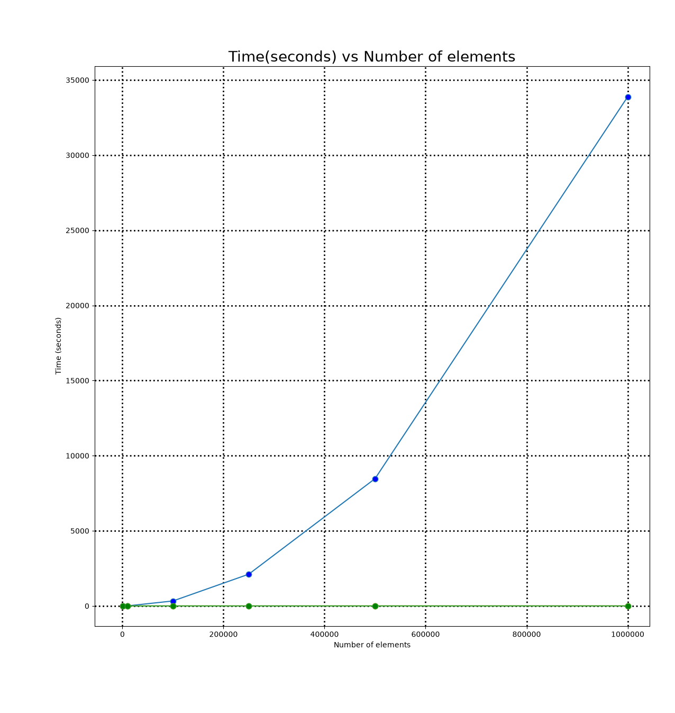

## Student Information

- **Name:** Brycen Anderson
- **Student ID:** 111017061
- **Class:** CSCI 3412-001 — Algorithms
- **Homework #:** HW3
- **Due Date:** 10/11/2026

---

## Problem Solving

### part 1 problem Array of matching pairs [5 points]

In a very large library, each book has a unique cover. Due to a recent
renovation, all the books and their covers have been separated and piled
up without any sorting. Your task is to devise an efficient algorithm that
matches each book to its corresponding cover. One critical restriction is that
you cannot directly compare two books or two covers. In other words, they can't
be sorted. Comparisons can only be made between a book and its cover to
determine whether they match or which is larger,based on predefined criteria.

#### Answer 1.1)

My first thought is to brute force it first that's easy take one book.
compare against all covers remove a cover and book when found just go to
the next book and do the same. But that is O(n^2) time so lets not.

##### My second thought

###### array of books

[["Red Rising","Golden Son","Morning Star","Iron Gold"
,"Dark Age","Light Bringer","Red god"]]

###### Array of covers

[["Red god","Iron Gold","Light Bringer","Morning Star",
"Golden Son","Dark Age","Red Rising"]]

1. Pick a random book. Compare it with every cover, finding its matching cover
and separating the remaining covers into smaller and larger groups

2. Use that matching cover to separate the remaining books into smaller and
larger groups also.

3. Repeat within the corresponding smaller groups and larger groups until every
pair is matched.

### 1.2

1) Yes. A comparison-based sort determines order by comparing elements.
Heapsort compares parent and child values to build and maintain the heap.

2) No. A stable sort preserves the original order 1a,1b,1c but heapsort
will give something like 1b,1c,1a not stable.

3) min heap [1a,1b]. swapping the root with the last element produces [1b,1a],
reversing the equal elements of the original array. but still it is sorted

4) No. Heapsort runs in O(n log n) regardless of the initial input
but the number of comparisons and swaps may vary.

5) Heapsort is useful when sorting a large array with limited extra memory and guarantees
O(n log n) worst-case time. It uses O(1) extra space, unlike mergesort and
avoids quicksort's O(n^2) worst case.

### part 2 Time Efficiency Exercise [10 points]

a = 4
b = 2
d = 1

T(n) = 4T(n/2) + n
T(n) = 4(4T(n/4) + n/2) + n
T(n) = 16T(n/4) + 3n
T(n) = 16(4T(n/8) + n/4) + 3n
T(n) = 64T(n/8) + 7n

T(n) = 4^k * T(n/2^k) + (2^k - 1)n
k = log n
2^k = n
4^k = n^2

T(n) = n^2T(1) + (n-1)n
since T(1) is constant,T(n) = O(n^2)

#### 2.2

A)

```python
def example1 (n):
    count = 0
    for i in range(n):
        j = 1
        while j < n:
            count += 1
            j *= 2  
    return count
```

T(n) = n log n
The outer loop runs n times. The inner loop runs log2 n times because j doubles
every iteration.

B)

```python
def example2 (n):
    count = 0
    for i in range(n):                    
        for j in range(n):                
            for k in range(min(2, i+1)):  
                for l in range(min(3, j+1)):  
                    count += 1                    
    return count
```

T(n) = n * n * 2 * 3
T(n) = O(n^2)
The 1st outer most loops n times 2nd loop also loops n times but the inner loops
will at most loop 2 * 3 = 6 times per pair of outer loop iterations.

#### 2.3

1) log2 n = O(log n) grows slower than any positive power of n

2) sqroot(2n) = O(n^1/2) you can so sqroot(n) like n^1/2 which is better then
most but not log n

3) 3n^2 + 5n + 10 = O(n^2) is dominated by n^2 giving O(n^2)

4) n^3 = O(n^3) this will grows very fast for all n multiply n by itself 3 times

5) 2^n = O(2^n) grows very fast 2*2 for every n added

6) n^n = O(n^n) this 1^1 but then 2^2 then 3^3 this will shoot to the sky in
operations.

### part 3

#### A

so insertion sort is O(k^2) operations if merging is O(n/k) then if you
do insertion sort when you get to k elements instead of splitting all
the way down this will be k^2 * n/k
T(n) = O(nk)

#### B

mergesort is O(n lg(n/k)) because you have n elements you split those n
elements k times till subset of n is 1 then you build going back up with
recursion. but it must look at every element to compare them so the total is
O(n) * O(lg(n/k)) = O(n lg(n/k))

#### C

what is the largest k so that insertion sort makes the mergesort algorithm
faster before it gets to a point where insertion sort slows the program.

### Part 3.2

#### quick Sort

```python
#Brycen Quicksort 
def quicksort(arr:list[int],start:int,end:int):
    #base case
    if end - start + 1 <= 1:
        return arr

    #pivot value
    pivot = arr[end]

    #pointer to the start of this array
    left = start

    #partition
    for i in range(start,end):
        if arr[i] < pivot:
            arr[left],arr[i] = arr[i],arr[left]
            left += 1

    #move pivot in middle of left and right sides
    arr[end] = arr[left]
    arr[left] = pivot
    
    #sort right and left sides 
    quicksort(arr,start,left-1)
    quicksort(arr,left + 1,end)

    return arr
    
```

##### output Quick Sort

```bash
    Array size:1000
    Function Name: quicksort
    Real Time:521630 ns
    OutPut
    [546, 828, 903, 1537, 2512, 3208, 3549, 4121, 4641, 5322]

    Array size:10000
    Function Name: quicksort
    Real Time:7.732 ms
    OutPut
    [0, 50, 102, 107, 193, 436, 479, 558, 804, 897]

    Array size:100000
    Function Name: quicksort
    Real Time:96.278 ms
    OutPut
    [0, 3, 21, 28, 50, 54, 56, 84, 95, 102]

    Array size:250000
    Function Name: quicksort
    Real Time:236.906 ms
    OutPut
    [0, 2, 3, 5, 9, 10, 15, 16, 18, 21]

    Array size:500000
    Function Name: quicksort
    Real Time:510.831 ms
    OutPut
    [0, 2, 3, 5, 5, 6, 9, 10, 15, 16]
```

#### bubble sort

```python
    #bubble up the largest number in array then n-1 for every loop O(n^2) time still tho
    #Brycen Bubble sort
    def bubblesort(arr:list[int]):
        #this is for n-1 1 less element to look at after each loop
        n = len(arr)
        #if flip 1 or more loop if not stop
        flip = 1
        while flip:
            flip = 0
            for i in range(n-1):
                #if i is larger than i+1 swap
                if(arr[i] > arr[i+1]):
                    arr[i],arr[i+1] = arr[i+1],arr[i]
                    flip+=1
            #end is sorted
            n-=1
        return arr

```

##### output Bubble Sort

```bash
    Array size:1000
    Function Name: bubblesort
    Real Time:26.695 ms
    OutPut
    [546, 828, 903, 1537, 2512, 3208, 3549, 4121, 4641, 5322]

    Array size:10000
    Function Name: bubblesort
    Real Time:3.218 seconds
    OutPut
    [0, 50, 102, 107, 193, 436, 479, 558, 804, 897]

    Array size:100000
    Function Name: bubblesort
    Real Time:5.510 minutes
    OutPut
    [0, 3, 21, 28, 50, 54, 56, 84, 95, 102]

    Array size:250000
    Function Name: bubblesort
    Real Time:35.197 minutes
    OutPut
    [0, 2, 3, 5, 9, 10, 15, 16, 18, 21]

    Array size:500000
    Function Name: bubblesort
    Real Time:2.353 hours
    OutPut
    [0, 2, 3, 5, 5, 6, 9, 10, 15, 16]

```

#### quick Bubble Sort

```python
def quickBubbleSort(arr:list[int],start:int,end:int,k:int):
    if end - start + 1 <= 1:
        return arr

    #base case is now just bubblesort 
    if end - start + 1 <= k:
        n = end
        flip = 1
        while flip:
            flip = 0
            for i in range(start,n):
                if arr[i] > arr[i+1]:
                    arr[i],arr[i+1] = arr[i+1],arr[i]
                    flip+= 1
            n-=1
        return arr
    
    #set pivot
    pivot = arr[end]
    left = start
    
    #loop through array
    for i in range(start,end):
        if arr[i] < pivot:
            arr[left],arr[i] = arr[i],arr[left]
            left+=1

    arr[end] = arr[left]
    arr[left] = pivot

    quickBubbleSort(arr,start,left-1,k)
    quickBubbleSort(arr,left+1,end,k)

    return arr
```

##### Bubble Sort output

```bash
    Array size:1000
    Function Name: quickBubbleSort
    Real Time:517960 ns
    OutPut
    [546, 828, 903, 1537, 2512, 3208, 3549, 4121, 4641, 5322]

    Array size:10000
    Function Name: quickBubbleSort
    Real Time:7.819 ms
    OutPut
    [0, 50, 102, 107, 193, 436, 479, 558, 804, 897]

    Array size:100000
    Function Name: quickBubbleSort
    Real Time:94.075 ms
    OutPut
    [0, 3, 21, 28, 50, 54, 56, 84, 95, 102]

    Array size:250000
    Function Name: quickBubbleSort
    Real Time:241.317 ms
    OutPut
    [0, 2, 3, 5, 9, 10, 15, 16, 18, 21]

    Array size:500000
    Function Name: quickBubbleSort
    Real Time:519.195 ms
    OutPut
    [0, 2, 3, 5, 5, 6, 9, 10, 15, 16]

```

#### Efficiency

```python
def timeEfficiency(funcName, *args,**keys):
    #start timer
    start = time.perf_counter_ns()
    
    #run program
    result = funcName(*args,**keys)
    
    #end timer get total time 
    end = time.perf_counter_ns()
    elapsed = end - start
    
    #formatting and adding to plotting arrays
    took = ""
    if funcName.__name__ == "bubblesort":
        bubbletimes.append(elapsed/1000000000)
    elif funcName.__name__ == "quicksort":
        quicktimes.append(elapsed/1000000000)
    else:
        k.append(elapsed/1000000000)
    

    if elapsed >= 3600000000000:
        took = f"{elapsed/3600000000000:.3f} hours"
    elif elapsed >= 60000000000:
        took = f"{elapsed/60000000000:.3f} minutes"
    elif elapsed >= 1000000000:
        took = f"{elapsed/1000000000:.3f} seconds"
    elif elapsed >= 1000000:
        took = f"{elapsed / 1000000:.3f} ms"
    else:
        took = f"{elapsed} ns" 
    
    return ["Function Name: " + str(funcName.__name__)  + "\nReal Time:" + took + "\nOutPut\n" + str(result[:10]) + "\n",elapsed/1000000000]
```

#### finding k

```python

def findingk():
    with open("rand1000000.txt", "r") as file:
        arr = [int(value) for value in file.read().split()]

    times = {}

    #check 100 elements prob to much
    for cutoff in range(1, 101):
        times[cutoff] = timeEfficiency(quickBubbleSort, arr.copy(), 0, len(arr) - 1, cutoff)[1]

        #i added to make sure its running
        print(f"Finished cutoff {cutoff}: {times[cutoff]:.6f} seconds",flush=True)

    # Select the cutoff with the lowest measured time
    best_k = min(times, key=lambda cutoff: times[cutoff])

    print(f"\nBest cutoff from 1-100: {best_k} elements\n")

    #to show where the best k is 
    for offset, label in zip(
        [-7, -5, -3, 0, 3, 5, 7],
        ["k-7", "k-5", "k-3", "k", "k+3", "k+5", "k+7"]
    ):
        cutoff = best_k + offset

        #i can't sort 0 elements
        if cutoff < 1:
            print(f"{label}: N/A (cutoff {cutoff} is below 1)")
            continue

        if cutoff not in times:
            times[cutoff] = timeEfficiency( quickBubbleSort, arr.copy(), 0, len(arr) - 1, cutoff)[1]
        
        print(f"{label}: {times[cutoff]:.6f} seconds")

    return best_k
```

##### finding k output

```bash
    k-7: N/A (cutoff -4 is below 1)
    k-5: N/A (cutoff -2 is below 1)
    k-3: N/A (cutoff 0 is below 1)
    k: 1.140438 seconds
    k+3: 1.165552 seconds
    k+5: 1.165209 seconds
    k+7: 1.185696 seconds
```

#### plot

```python
def plot(size:list[int]):
    #plotting for bubble,quick, together sorting 
    plt.plot(size,bubbletimes,label="Bubble Sort" ,marker=".",ms=15,markerfacecolor="blue")
    plt.plot(size,quicktimes,label="Quick Sort",marker=".",ms=15,markerfacecolor="orange")
    plt.plot(size,k,label="QuickBubble Sort",marker=".",ms=15,markerfacecolor="green")

    #title of graph
    plt.title("Time(seconds) vs Number of elements",fontsize=20)
    
    #label x and y, space evenly 
    plt.ticklabel_format(axis="x",style="plain",useOffset=False)
    plt.ylabel("Time (seconds)")
    plt.xlabel("Number of elements")
    plt.tight_layout()
    plt.grid(axis="both",linewidth=2,color="black",linestyle="dotted")
    plt.show()
```

##### plot Output



#### main

```python

def main():
    best_k = findingk()
    k.clear()
    fileNames = ["rand1000.txt","rand10000.txt","rand100000.txt","rand250000.txt","rand500000.txt","rand1000000.txt"]
    size = [1000,10000,100000,250000,500000,1000000]
    n = 0
    for name in fileNames:
        with open(name,"r") as file:
            arr = [int(value) for value in file.read().split()]
            print(f"Array size:{size[n]}\n" + timeEfficiency(quicksort,arr.copy(),0,len(arr)-1)[0])
            print(f"Array size:{size[n]}\n" + timeEfficiency(bubblesort,arr.copy())[0])
            print(f"Array size:{size[n]}\n" + timeEfficiency(quickBubbleSort,arr.copy(),0,len(arr)-1,best_k)[0])
            n += 1

            #if input("Look at output Enter when done and it will go to the next q to quit-> ") == 'q':
            #   break
    plot(size)
```

### AI homework


[YouTube video](https://www.youtube.com/watch?v=HTUh0OO6Kmo)

#### Reflection

Using AI to create Tetris showed me the difference between getting code and
understanding how that code works. The AI could generate a complete game with
controls and scoring, but understanding the generated code required additional
time because I had not worked through the implementation myself.

The restriction on writing code made this experience different from how I would
normally approach a programming project. Tetris seemed like something I would
have enjoyed implementing, and I missed the opportunity to make decisions and
work through problems myself. Reviewing unfamiliar code required effort, but I
did not feel it provided the same practice with algorithms as writing and
debugging the game would have.

Revising the project was also challenging. I had to prompt the AI multiple times
to get the project correct. Requests for small changes often produced versions
that did not work, so I ended up starting over with a new prompt. Without a
strong understanding of the generated code, it was difficult to identify what
had gone wrong or decide how to fix it. Explanations alone did not give me the
same familiarity I develop when implementing a program myself.

I remain open to using AI, but this approach felt less engaging than building
the project myself. Much of my enjoyment in programming comes from solving
problems and understanding how my decisions affect the result. I would prefer
to use AI to support that process while still taking an active role in
implementation. That would give me more opportunities to practice, understand
the code, and feel a sense of accomplishment.

##### Full output

This is so far program is still running for last bubble Sort

```bash
[bryruto@Brycen-archlinux hw3]$ python main.py
Finished cutoff 1: 1.196035 seconds
Finished cutoff 2: 1.167473 seconds
Finished cutoff 3: 1.140438 seconds
Finished cutoff 4: 1.148377 seconds
Finished cutoff 5: 1.162331 seconds
Finished cutoff 6: 1.165552 seconds
Finished cutoff 7: 1.171136 seconds
Finished cutoff 8: 1.165209 seconds
Finished cutoff 9: 1.176651 seconds
Finished cutoff 10: 1.185696 seconds
Finished cutoff 11: 1.197015 seconds
Finished cutoff 12: 1.210267 seconds
Finished cutoff 13: 1.225156 seconds
Finished cutoff 14: 1.237560 seconds
Finished cutoff 15: 1.253796 seconds
Finished cutoff 16: 1.270276 seconds
Finished cutoff 17: 1.284010 seconds
Finished cutoff 18: 1.302045 seconds
Finished cutoff 19: 1.317486 seconds
Finished cutoff 20: 1.333579 seconds
Finished cutoff 21: 1.341553 seconds
Finished cutoff 22: 1.362831 seconds
Finished cutoff 23: 1.381764 seconds
Finished cutoff 24: 1.391440 seconds
Finished cutoff 25: 1.414591 seconds
Finished cutoff 26: 1.429648 seconds
Finished cutoff 27: 1.444962 seconds
Finished cutoff 28: 1.466294 seconds
Finished cutoff 29: 1.479447 seconds
Finished cutoff 30: 1.499074 seconds
Finished cutoff 31: 1.515827 seconds
Finished cutoff 32: 1.536510 seconds
Finished cutoff 33: 1.549916 seconds
Finished cutoff 34: 1.567477 seconds
Finished cutoff 35: 1.580940 seconds
Finished cutoff 36: 1.604414 seconds
Finished cutoff 37: 1.623749 seconds
Finished cutoff 38: 1.644085 seconds
Finished cutoff 39: 1.677873 seconds
Finished cutoff 40: 1.672651 seconds
Finished cutoff 41: 1.684338 seconds
Finished cutoff 42: 1.702309 seconds
Finished cutoff 43: 1.723496 seconds
Finished cutoff 44: 1.731048 seconds
Finished cutoff 45: 1.757375 seconds
Finished cutoff 46: 1.780423 seconds
Finished cutoff 47: 1.799618 seconds
Finished cutoff 48: 1.813016 seconds
Finished cutoff 49: 1.820207 seconds
Finished cutoff 50: 1.845575 seconds
Finished cutoff 51: 1.857454 seconds
Finished cutoff 52: 1.884199 seconds
Finished cutoff 53: 1.911606 seconds
Finished cutoff 54: 1.946277 seconds
Finished cutoff 55: 1.953481 seconds
Finished cutoff 56: 1.970346 seconds
Finished cutoff 57: 1.966968 seconds
Finished cutoff 58: 1.993158 seconds
Finished cutoff 59: 2.010780 seconds
Finished cutoff 60: 2.053964 seconds
Finished cutoff 61: 2.050975 seconds
Finished cutoff 62: 2.074750 seconds
Finished cutoff 63: 2.088644 seconds
Finished cutoff 64: 2.112828 seconds
Finished cutoff 65: 2.140831 seconds
Finished cutoff 66: 2.169428 seconds
Finished cutoff 67: 2.223911 seconds
Finished cutoff 68: 2.199048 seconds
Finished cutoff 69: 2.209157 seconds
Finished cutoff 70: 2.233735 seconds
Finished cutoff 71: 2.249350 seconds
Finished cutoff 72: 2.299047 seconds
Finished cutoff 73: 2.358416 seconds
Finished cutoff 74: 2.309297 seconds
Finished cutoff 75: 2.364283 seconds
Finished cutoff 76: 2.342029 seconds
Finished cutoff 77: 2.400366 seconds
Finished cutoff 78: 2.408865 seconds
Finished cutoff 79: 2.451624 seconds
Finished cutoff 80: 2.477215 seconds
Finished cutoff 81: 2.493406 seconds
Finished cutoff 82: 2.531102 seconds
Finished cutoff 83: 2.549648 seconds
Finished cutoff 84: 2.557945 seconds
Finished cutoff 85: 2.574018 seconds
Finished cutoff 86: 2.611904 seconds
Finished cutoff 87: 2.606258 seconds
Finished cutoff 88: 2.644945 seconds
Finished cutoff 89: 2.640305 seconds
Finished cutoff 90: 2.677399 seconds
Finished cutoff 91: 2.675775 seconds
Finished cutoff 92: 2.668963 seconds
Finished cutoff 93: 2.651638 seconds
Finished cutoff 94: 2.674625 seconds
Finished cutoff 95: 2.676668 seconds
Finished cutoff 96: 2.706654 seconds
Finished cutoff 97: 2.720115 seconds
Finished cutoff 98: 2.731872 seconds
Finished cutoff 99: 2.734523 seconds
Finished cutoff 100: 2.770367 seconds

Best cutoff from 1-100: 3 elements

k-7: N/A (cutoff -4 is below 1)
k-5: N/A (cutoff -2 is below 1)
k-3: N/A (cutoff 0 is below 1)
k: 1.140438 seconds
k+3: 1.165552 seconds
k+5: 1.165209 seconds
k+7: 1.185696 seconds
Array size:1000
Function Name: quicksort
Real Time:521630 ns
OutPut
[546, 828, 903, 1537, 2512, 3208, 3549, 4121, 4641, 5322]

Array size:1000
Function Name: bubblesort
Real Time:26.695 ms
OutPut
[546, 828, 903, 1537, 2512, 3208, 3549, 4121, 4641, 5322]

Array size:1000
Function Name: quickBubbleSort
Real Time:517960 ns
OutPut
[546, 828, 903, 1537, 2512, 3208, 3549, 4121, 4641, 5322]

Array size:10000
Function Name: quicksort
Real Time:7.732 ms
OutPut
[0, 50, 102, 107, 193, 436, 479, 558, 804, 897]

Array size:10000
Function Name: bubblesort
Real Time:3.218 seconds
OutPut
[0, 50, 102, 107, 193, 436, 479, 558, 804, 897]

Array size:10000
Function Name: quickBubbleSort
Real Time:7.819 ms
OutPut
[0, 50, 102, 107, 193, 436, 479, 558, 804, 897]

Array size:100000
Function Name: quicksort
Real Time:96.278 ms
OutPut
[0, 3, 21, 28, 50, 54, 56, 84, 95, 102]

Array size:100000
Function Name: bubblesort
Real Time:5.510 minutes
OutPut
[0, 3, 21, 28, 50, 54, 56, 84, 95, 102]

Array size:100000
Function Name: quickBubbleSort
Real Time:94.075 ms
OutPut
[0, 3, 21, 28, 50, 54, 56, 84, 95, 102]

Array size:250000
Function Name: quicksort
Real Time:236.906 ms
OutPut
[0, 2, 3, 5, 9, 10, 15, 16, 18, 21]

Array size:250000
Function Name: bubblesort
Real Time:35.197 minutes
OutPut
[0, 2, 3, 5, 9, 10, 15, 16, 18, 21]

Array size:250000
Function Name: quickBubbleSort
Real Time:241.317 ms
OutPut
[0, 2, 3, 5, 9, 10, 15, 16, 18, 21]

Array size:500000
Function Name: quicksort
Real Time:510.831 ms
OutPut
[0, 2, 3, 5, 5, 6, 9, 10, 15, 16]

Array size:500000
Function Name: bubblesort
Real Time:2.353 hours
OutPut
[0, 2, 3, 5, 5, 6, 9, 10, 15, 16]

Array size:500000
Function Name: quickBubbleSort
Real Time:519.195 ms
OutPut
[0, 2, 3, 5, 5, 6, 9, 10, 15, 16]

Array size:1000000
Function Name: quicksort
Real Time:1.141 seconds
OutPut
[0, 1, 2, 3, 3, 3, 5, 5, 5, 6]
```

#### extra 3 recursion

##### Direct recursion

A function is called direct recursive if it calls the same function
again this is what people do for quick sort most of the time.

##### Indirect recursion

A function is indirect recursive if it calls another function and then
calls itself after or in a different function.for indirect recursion
you will need at least 2 functions

##### Tail recursion

A tail recursion function is when the last call is the recursive part of
the function, and there's no need to keep record of the previous state.

#### my Find

```python
#!/usr/bin/python3

import os
import stat
import sys

def myFind(directory, substring):
    directory = os.path.abspath(directory)
    matches = []
    total_size = 0

    #list directory and go down path total up bytes 
    for name in os.listdir(directory):
        path = os.path.join(directory, name)
        info = os.lstat(path)

        if substring in name:
            matches.append(path)

            if stat.S_ISREG(info.st_mode):
                print(f"{path}  {info.st_size:,} bytes")
                total_size += info.st_size
            else:
                print(path)

        if stat.S_ISDIR(info.st_mode):
            # search the subfolder using the same function.
            found, size = myFind(path, substring)
            matches.extend(found)
            total_size += size

    return matches, total_size

if __name__ =="__main__":
    files, total = myFind(sys.argv[1], sys.argv[2])
    print(f"\nTotal file size: {total:,} bytes")
```

##### my find output

```bash
[bryruto@Brycen-archlinux hw3]$ chmod 755 myfind.py
[bryruto@Brycen-archlinux hw3]$ ./myfind.py /usr/bin mk
/usr/bin/grub-mkfont  146,840 bytes
/usr/bin/grub-mkrescue  1,541,320 bytes
/usr/bin/mkrfc2734  14,432 bytes
/usr/bin/mk_cmds  1,104 bytes
/usr/bin/mkfs.ext4  141,672 bytes
/usr/bin/mkfs.minix  43,192 bytes
/usr/bin/mkinitcpio  44,194 bytes
/usr/bin/mkfs.ext2  141,672 bytes
/usr/bin/gdiffmk  6,843 bytes
/usr/bin/grub-mknetdir  566,568 bytes
/usr/bin/mkfs.cramfs  34,920 bytes
/usr/bin/mktemp  47,416 bytes
/usr/bin/grub-mkstandalone  675,728 bytes
/usr/bin/symkeyutil  31,768 bytes
/usr/bin/mke2fs  141,672 bytes
/usr/bin/mkdir  51,512 bytes
/usr/bin/grub-mkpasswd-argon2  199,472 bytes
/usr/bin/mkhomedir_helper  14,448 bytes
/usr/bin/mklost+found  14,352 bytes
/usr/bin/grub-mkpasswd-pbkdf2  149,584 bytes
/usr/bin/grub-mklayout  119,704 bytes
/usr/bin/mknod  51,512 bytes
/usr/bin/grub-mkrelpath  321,712 bytes
/usr/bin/mkswap  47,272 bytes
/usr/bin/mkfifo  47,416 bytes
/usr/bin/mkd2html  14,608 bytes
/usr/bin/mkfs.bfs  22,696 bytes
/usr/bin/grub-mkconfig  9,836 bytes
/usr/bin/h5mkgrp  14,632 bytes
/usr/bin/mkfs  14,496 bytes
/usr/bin/mkfs.ext3  141,672 bytes
/usr/bin/grub-mkimage  495,720 bytes
/usr/bin/ipcmk  22,760 bytes
/usr/bin/mkcomposefs  34,936 bytes

Total file size: 5,367,681 bytes
```
