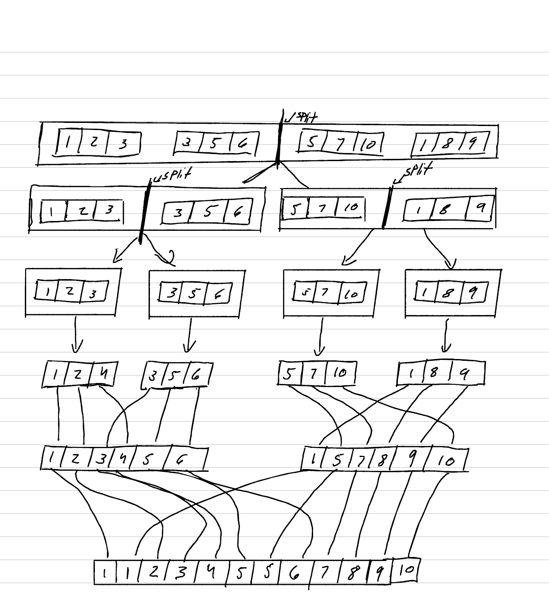

# Student Information

- **Name:** Brycen Anderson
- **Student ID:** 111017061
- **Class:** CSCI 3412-001 — Algorithms
- **Homework #:** HW3
- **Due Date:** 10/11/2026

---

## Part A

### Part 1 Pseudocode

NOTE- This is 2 function's split and merge of merge sort

1) Take array of array's
2) split array of array's in half till you hit only 1 array
    2a) find middle store that in variable middle
    2b) split array of array's to left and right array of array's
    2c) store those in variables left and right array
    NOTE - middle is the end of right and start for left
    2d) call split for both right and left array of arrays
3) loop till left and right are empty
    3a) compare left[l] and right[r]
    3b) add what ever value is smaller to result array
    3c) add 1 to l or r
4) loop left array if any
    4a) add to result array
    4b) add 1 to l
5) loop right array if any
    5a) add to result array
    5b) add 1 to r
6) return result

### Part 2 Explain

So for this problem my idea is to merge sort the array's not the element's
I will run this till it hits the base case then combine the 2 array's
elements into 1 array.The time complexity of split part of merge sort
is O(log k) where k is the number of arrays in the array,then at the merge
part we will look at every element in the 2 array's giving T(2n) but that ok
because we don't care about constants and get O(n).Then combine
the split and merge part to get O(n log k) total time complexity.

## Part B

### Part 1 Prepare

```python
def prepare(file_Name:str): # returns array of arrays or you can say matrix or 2d array
    
    with open(file_Name,"r") as file:
        #make array of arrays 
        array_of_arrays = []
        # make array with all elements
        nums = file.read().split()

    #so nums is now my array with all the elements
    tmp = []
    for num in nums:
        if len(tmp) == 10_000:
            array_of_arrays.append(tmp)
            tmp = []

        tmp.append(int(num))
    if tmp:
        array_of_arrays.append(tmp)

    return array_of_arrays

# pytest prepare.py 
def test_prepare():
    test_size()
    test_Pre_Array_size()
    test_prepare_fixtmp()

def test_prepare_fixtmp():
    arr = prepare("rand1000000.txt")

    assert len(arr) == 100, "Should have 100 sublists"
    assert all(len(sub) == 10_000 for sub in arr), "All sublists should have 10,000 elements"
    assert arr[0] is not arr[1], "Sublists should be separate objects"

#all of my files will have a main for testing that file 
def test_size():
    arr = prepare("rand1000000.txt")
    assert len(arr) == 100, "should be the 100 sublist"

#test should be in separate file 
def test_Pre_Array_size():
    arr = prepare("rand1000000.txt")
    for i in range(len(arr)):
        assert len(arr[i]) == 10_000,"should have 10,000 elements per sublist"

if __name__ == "__main__":
    test_prepare()
```

#### prepare test

```kitty
============================= test session starts ==============================
platform linux -- Python 3.14.9, pytest-9.2.0, pluggy-1.7.0
rootdir: /home/bryruto/CuDenver/Algorithms/out/hw4
plugins: platformdirs-4.13.5, mock-3.16.0, anyio-4.16.0
collected 4 items

prepare.py ....                                                          [100%]

============================== 4 passed in 0.70s ===============================
```

#### explain prepare

So for this i used 'with open' so that i can open the file and it will
automatically close for me when i leave the scope.I knew that .read() would
read the whole file and .split() will split with a delimiter ' ' by default
which will then make everything a huge array after that i make them into
array of array by counting up till 10_000 then appending to my array_of_arrays
then to make sure it would work and to force myself to write test
i used pytest to test my function making sure all lengths were right.

### Part 2 100 sub-list

#### Radix Sort

```python

#return nothing pass by ref 
def RadixSort(arr:list):
    #check to see if the array is empty if so return empty
    if not arr:
        return []

    # while not sorted only running 1 array at a time
    count=0
    while not is_it_sorted(arr):

        #make array of 0's
        counts = [0 for _ in range(10)]

        #loop through nums 
        for num in arr:  
            #find the index of where you want those arrays
            index = (num//(10**count)) % 10
            counts[index]+=1

        #then we want to add them up
        sum = 0
        for i in range(len(counts)):
            if counts[i] == 0:
                continue

            sum += counts[i]
            counts[i] = sum
        
        new_arr = arr.copy()

        #now we want to store all elements in order 
        for i in range(len(arr) -1,-1,-1):
            index = arr[i]
            
            #this is repeated work how do i make this better
            index = (arr[i]//(10**count)) % 10
            
            new_arr[counts[index]-1] = arr[i]
            counts[index]-=1
        
        arr[:] = new_arr #update to the new array
        count+=1

    return arr


#this just will look to see if we need to swap any values if we do not sorted yet
def is_it_sorted(arr:list)->bool:
    for i in range(len(arr)-1):
        if arr[i] > arr[i+1]:
            return False
    return True


#these are the test 
def test_RadixSort():
    test_empty()
    test_sorts_right()

#test for if the array is empty
def test_empty():
    assert RadixSort([]) == [],"the array is empty"

#test for if sorting is working 
def test_sorts_right():
    assert RadixSort([170, 45, 75, 90, 802, 24, 2, 66]) == [2,24,45,66,75,90,170,802]


if __name__ == "__main__":
    test_RadixSort()
```

##### RadixSort Test

```kitty

============================= test session starts ==============================
platform linux -- Python 3.14.9, pytest-9.2.0, pluggy-1.7.0
rootdir: /home/bryruto/CuDenver/Algorithms/out/hw4
plugins: platformdirs-4.13.5, mock-3.16.0, anyio-4.16.0
collected 3 items

radixsort.py ...                                                         [100%]

============================== 3 passed in 0.01s ===============================
```

##### Explain RadixSort

My radix sort first checks if the array is sorted, then uses counting sort to
organize each digit until the array is sorted. I use cumulative counts to find
the correct positions and loop backward to keep the sorting stable. The time
complexity is O(dn) because each digit requires O(n) work, where d is the
number of digits. The space complexity is O(n) because I create a copy of the
original array, while my counting array only uses O(1) space.

#### Bucket Sort

```python

def bucketSort(arr):
    if not arr:
        return []
    
    #make the bucket in way of a hashmap
    buckets = {}# numbers -> counts
    largest, smallest = arr[0],arr[0]

    #looping through the elements to make all the buckets
    for num in arr:
        if num in buckets:
            buckets[num] += 1
        else:
            buckets[num] = 1
        
        largest = max(largest,num)
        smallest = min(smallest,num)
    
    #make a array for the result
    result = []
        
    # then clear out the bucket inorder 
    for i in range(smallest,largest + 1):
        if i in buckets:
            for j in range(buckets[i]): 
                result.append(i)

    #return the result
    return result

#run test on Bucket sort 
def test_bucketSort():
    test_bucket_empty()
    test_bucket_sorts()

#test if the array is empty 
def test_bucket_empty():
    assert bucketSort([]) == [], "the array is empty"

def test_bucket_sorts():
    assert bucketSort([42, 0, 99, 17, 42, 5, 88, 1, 73, 17, 50, 2, 99, 36, 64, 0]) == [0, 0, 1, 2, 5, 17, 17, 36, 42, 42, 50, 64, 73, 88, 99, 99], "the sort is not working"


if __name__ == "__main__":
    test_bucketSort()
```

##### BucketSort Test

```kitty

============================= test session starts ==============================
platform linux -- Python 3.14.9, pytest-9.2.0, pluggy-1.7.0
rootdir: /home/bryruto/CuDenver/Algorithms/out/hw4
plugins: platformdirs-4.13.5, mock-3.16.0, anyio-4.16.0
collected 3 items

BucketSort.py ...                                                        [100%]

============================== 3 passed in 0.01s ===============================
```

##### Explain BucketSort

For my bucket sort, I first check if the array is empty , then use
a hash map to count how many times each number appears. I find the smallest and
largest values to determine the range I need to iterate through, then append
each number based on its count. The time complexity is O(n + r), where n is the
number of elements and r is the range between the smallest and largest values.
The space complexity is O(n) because I store the counts in a hash map and create
a new sorted array

### Merges Part 3

#### Merge Code

```python
#this is for fast merge 
def fast_merge(arrs_in_arr:list):
    #check to see if its empty 
    if len(arrs_in_arr) == 0:
        return []

    #check to see if at base case
    if len(arrs_in_arr) <= 1:
        return arrs_in_arr[0]

    #get the middle of the array
    mid = len(arrs_in_arr)// 2

    #left and right sub array
    left = arrs_in_arr[:mid]
    right = arrs_in_arr[mid:]
    
    #sort left and right sub arrays 
    left = fast_merge(left)
    right = fast_merge(right) 

    return merge([left,right])

#this will be merging them in order slower
def merge(arrs_in_arr:list):

    #so lets just merge 2 arrays at a time for slower normal merge 
    while len(arrs_in_arr) > 1:

        #making my tmp array and 2 others that i will merge
        tmp = []
        arr1 = arrs_in_arr.pop()
        arr2 = arrs_in_arr.pop()
        
        # these are my left and right pointers
        #also the length just a bit fast this way
        l,r,size1,size2 = 0,0,len(arr1),len(arr2) 
        
        #add elements back into 1 array
        while l < size1 and r < size2:
            
            if arr1[l] <= arr2[r]:
                tmp.append(arr1[l])
                l+=1
        
            else:
                tmp.append(arr2[r])
                r+=1
        
        #any left in leftside add them
        while l < size1:
            tmp.append(arr1[l])
            l+=1

        #any left in rightside add them 
        while r < size2:
            tmp.append(arr2[r])
            r+=1
        
        #this is not great i should move this 
        arrs_in_arr.append(tmp)
    

    return arrs_in_arr[0]

        


def test_merges():
    test_fast_merge()
    test_merge()

def test_fast_merge():
    assert fast_merge([
    [1, 5, 9, 15],
    [2, 6, 10, 20],
    [0, 3, 7, 12],
    [4, 8, 11, 16],
    [1, 6, 13, 18],
    [5, 14, 21]]) == [0, 1, 1, 2, 3, 4, 5, 5, 6, 6, 7, 8, 9, 10, 11, 12, 13, 14, 15, 16, 18, 20, 21]

def test_merge():
    assert merge([
    [1, 5, 9, 15],
    [2, 6, 10, 20],
    [0, 3, 7, 12],
    [4, 8, 11, 16],
    [1, 6, 13, 18],
    [5, 14, 21]]) == [0, 1, 1, 2, 3, 4, 5, 5, 6, 6, 7, 8, 9, 10, 11, 12, 13, 14, 15, 16, 18, 20, 21]


if __name__ == "__main__":
    test_merges()
```

##### Merge Test

```kitty

============================= test session starts ==============================
platform linux -- Python 3.14.9, pytest-9.2.0, pluggy-1.7.0
rootdir: /home/bryruto/CuDenver/Algorithms/out/hw4
plugins: platformdirs-4.13.5, mock-3.16.0, anyio-4.16.0
collected 3 items

merges.py ...                                                            [100%]

============================== 3 passed in 0.01s ===============================
```

##### Slow Merge - O(nk)

For the slower merge, I took two sorted lists and merged them together,
then kept merging the result with the next list until only one was left.
This takes O(nk) time because the same numbers can be processed multiple times.

##### Fast Merge - O(n log k)

For the faster Merge, I used recursion to split the lists into two groups until
only one list was left in each group.  Then I merged them back together using my
slower merge function. This takes O(n log k) time because I'm merging the lists
in smaller groups instead of continuously growing one big list.

#### Time Efficiency Function Part 4

```Python
import time 
def timeEfficiency(funcName, *args,**keys):
    
    #start timer
    start = time.perf_counter_ns()
    
    #run program
    result = funcName(*args,**keys)
    
    #end timer get total time 
    end = time.perf_counter_ns()
    elapsed = end - start
    
    #getting the time in such a bad way but ya 
    if elapsed >= 3600000000000:
        took = f"{elapsed/3600000000000:.3f} hours"
    elif elapsed >= 60000000000:
        took = f"{elapsed/60000000000:.3f} minutes"
    elif elapsed >= 1000000000:
        took = f"{elapsed/1000000000:.3f} seconds"
    elif elapsed >= 1000000:
        took = f"{elapsed / 1000000:.3f} ms"
    else:
        took = f"{elapsed} ns" 
    
    #return in array so i can index what i want to output
    return ["Function Name: " + str(funcName.__name__)  + "\nReal Time:" + took + "\nOutPut\n" + str(result[:10]),result]
```

##### Time Efficiency test

```kitty

============================= test session starts ==============================
platform linux -- Python 3.14.9, pytest-9.2.0, pluggy-1.7.0
rootdir: /home/bryruto/CuDenver/Algorithms/out/hw4
plugins: platformdirs-4.13.5, mock-3.16.0, anyio-4.16.0
collected 1 item

TestFuction.py .                                                         [100%]

============================== 1 passed in 0.01s ===============================
```

##### Explain Time Efficiency

I implemented a function that records the starting time in nanoseconds, executes
a given function, and subtracts the starting time from the ending time.
The elapsed time is converted into the appropriate unit for readability.

##### Comparison

As k increases, the slower merge takes more time because it has to keep going
through the growing list.The faster merge handles this better because it divides
the work into halves, meaning it doesn't have to go through the same numbers as
many times.

##### Speedup

Speedup: I calculated the speedup by dividing the slower merge's time by the
faster merge's time

### Part 5 performance report

#### main at the end of part 2

```python
from prepare import prepare 
from BucketSort import bucketSort
from radixsort import RadixSort
from merges import fast_merge,merge
from TestFuction import timeEfficiency

#this is main
def main():
    #array of 100,10,000 elements per
    array = prepare("rand1000000.txt")
    
    print("Limited to 5 for space\n")
    
    # first 50 for RadixSort so if you change dont do more then 50
    print(f"before RadixSort ->\n{'\n'.join(str(arr[:5]) for arr in array[:5])}")
    print()
    # last 50 for BucketSort if you change dont do less then 50 to start 
    print(f"before BucketSort ->\n{'\n'.join(str(arr[:5]) for arr in array[50:55])}")

    first,last = [],[]
    #take file first 50 elements
    for arr in array[:50]: 
        first.append(RadixSort(arr))
    
    #take file last 50 elements 
    for arr in array[50:]:
        last.append(bucketSort(arr))

    print("-" * 50)
    print(f"After RadixSort ->\n{'\n'.join(str(arr[:5]) for arr in first[:5])}")
    print()
    print(f"After BucketSort ->\n{'\n'.join(str(arr[:5]) for arr in last[:5])}")


    #do both merge fast and merge slow and check result is equal on both
    time_fast_merge = timeEfficiency(fast_merge,array.copy())
    time_merge = timeEfficiency(merge,array.copy())
    

    # i passed back as array so i can index the print staments the way i want
    print()
    print(time_fast_merge[0])
    print("-" * 50)

    print()
    print(time_merge[0])
    print("-" * 50)

    print()
    print(f"DO THEY MATCH = {time_fast_merge[1] == time_merge[1]}")
    
    print(f"Fast Merge is {(time_merge[2] - time_fast_merge[2])/ 1_000_000_000:.2f} seconds Faster then Slow Merge")

#this is so main will only run if i run this file
if __name__ == "__main__":
    main()
```

#### main output as of now this will change later

```kitty
Limited to 5 for space

before RadixSort ->
[355934, 37735, 968741, 107465, 800642]
[650914, 419588, 801136, 772419, 577883]
[262690, 247914, 938602, 607532, 10271]
[185610, 638091, 900164, 470601, 769318]
[64709, 4063, 253835, 962135, 641242]

before BucketSort ->
[32160, 487897, 154586, 536083, 856808]
[450667, 847954, 662045, 421081, 100512]
[16766, 522630, 527766, 929402, 5523]
[807047, 345319, 585809, 68212, 526995]
[960275, 725759, 480733, 506268, 355143]
--------------------------------------------------
After RadixSort ->
[0, 50, 102, 107, 193]
[54, 56, 95, 117, 122]
[177, 202, 295, 321, 355]
[3, 84, 157, 186, 232]
[21, 255, 280, 345, 375]

After BucketSort ->
[98, 425, 514, 519, 556]
[41, 45, 100, 170, 172]
[152, 191, 211, 229, 231]
[65, 76, 116, 220, 619]
[85, 222, 241, 258, 395]
--------------------------------------------------

Function Name: fast_merge
Real Time:384.118 ms
OutPut
[0, 1, 2, 3, 3, 3, 5, 5, 5, 6]
--------------------------------------------------

Function Name: merge
Real Time:2.369 seconds
OutPut
[0, 1, 2, 3, 3, 3, 5, 5, 5, 6]
--------------------------------------------------

DO THEY MATCH-> True
is fast merge Sorted-> True
Is slow merge sorted-> True
size of Sorted fast merge-> 1000000
Size of Sorted slow merge-> 1000000
Fast Merge is 1.98 seconds Faster then Slow Merge
```

#### time Complexity

My slower merge has a time complexity of O(nk) because it keeps merging the
growing array with the next sorted sublist. This causes the same elements to be
processed multiple times.

My faster merge has a time complexity of O(n log k) because it recursively
divides the sublists in half and merges them back together. Each level processes
n elements, and there are log k levels.

#### Space complexity

Both merging algorithms have O(n) space complexity because they create temporary
arrays to store the merged elements. The faster merge also uses recursion, but
its overall space complexity remains O(n).

#### drawing



#### Overall Performance Output

My faster merge was about 6.23 times faster than my slower merge. This makes
sense because the faster merge has O(n log k) time complexity compared to O(nk)
for the slower merge.

As the number of sorted sublists k increases, the slower merge will take more
time because it has to repeatedly merge the growing result with another sublist.
The faster merge handles this better because it splits the sublists into smaller
groups, reducing the number of times each element gets processed.

## Question 2 Skip List

### My Skip List

```Python
import math
import random
#skiplist class 
class Brycen_SkipList:
    # in python i think the best way to do this would be a hashmap

    def __init__(self,max_elements):
        self.skiplist = {}
        self.element_count = 0
        self.height = math.ceil(math.log2(max_elements))
        
    #methods 
    def search(self,key)->bool:
        index = 0
        #search all levels backward 
        for level in range(self.height-1,-1,-1):
            # if the level is in there 
            if level in self.skiplist: 
                for num in range(index,len(self.skiplist[level])):
                    #i forgot about this My code is about to get very unreadable 
                    if self.skiplist[level][num] == key: return True
                    elif self.skiplist[level][num] > key: break
                    index+=1
        return False

    def insert(self,value):
        #get a random level
        level = 1 # always insert at 0 
        while level < self.height and random.randint(0,1) == 1:
            level +=1
        
        # add value to all levels till at it's level
        for i in range(level):
            if i in self.skiplist:
                self.skiplist[i].append(value)
                #must sort after because a skiplist is sorted 
                self.skiplist[i].sort()
                
            #if not in hashmap add it  
            else:
                self.skiplist[i] = [value]
```

#### how i build a array of 1_000_000 elements

'''python

'''

#### Skip List Explain

My skip list implementation uses a Python dictionary (hash map) to store
multiple levels of sorted lists. Each key in the dictionary represents a level,
and each value is a list containing the elements at that level. Level 0 contains
every inserted element, while the higher levels contain fewer elements based on
random selection. The maximum height is calculated using the base-2 logarithm of
the maximum number of elements.

#### search Explain

My search method starts at the highest level and works downward. It compares
elements against the target value, moving forward when an element is smaller and
moving down a level when an element is larger. I keep track of the current index
so I can skip some elements at lower levels. If the value is found, the method
returns True; otherwise, it returns False. Because my implementation uses lists
rather than node pointers, the search has a worst-case time complexity of
O(n + log m), which is O(n) when the maximum height is O(log n).

#### insert Explain

My insert method randomly determines how many levels a new element should
occupy. The element is always inserted into level 0, with a 50% chance of being
promoted to each additional level. The element is appended to each selected list
, which is then sorted to maintain the correct order. Because I sort the lists
after insertion, this is more expensive than insertion in a traditional skip
list. A general upper bound is O(n log n log m) in the worst case, where n is
the number of stored elements and m is the configured maximum number of
elements. Python's sorting algorithm is usually faster for my nearly sorted lists.

#### Space Complexity

My implementation stores elements in multiple sorted lists, meaning the same
element can appear at several levels. Since each element has a 50% chance of
being promoted to the next level, the expected number of copies per element is
less than two. This gives my implementation an expected space complexity of
O(n). In the worst case, every element could appear at every level, resulting in
O(n log m) space complexity, or O(n log n) when the maximum number of elements
is proportional to n.
