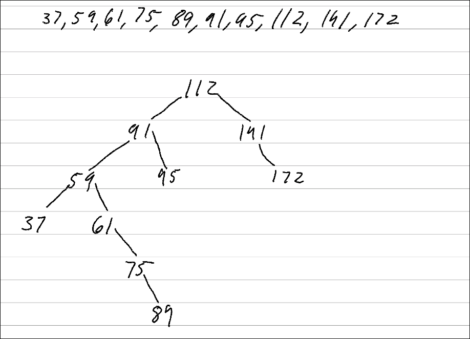
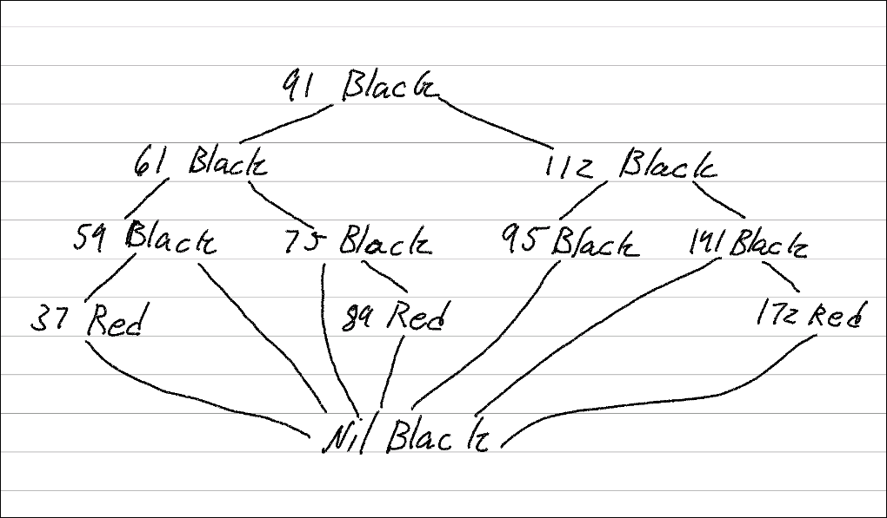
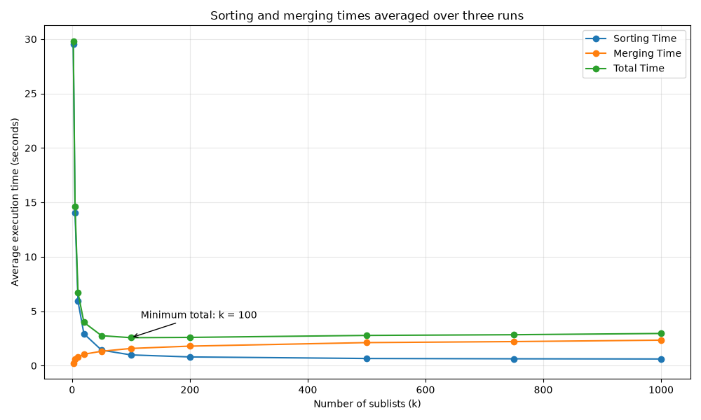

# Student Information

- **Name:** Brycen Anderson
- **Student ID:** 111017061
- **Class:** CSCI 3412-001 — Algorithms
- **Homework:** HW4
- **Due Date:** 11/06/2026

---

## Question 1 Merge Sorted Lists

### Part A

### Part 1 Pseudocode

NOTE- This is 2 function's split and merge of merge sort

1) Take array of array's
2) split array of array's in half till you hit only 1 array
    2a) find middle store that in variable middle
    2b) split array of array's to left and right array of array's
    2c) store those in variables left and right array
    NOTE - middle is where the left half ends and the right half starts
    2d) call split for both right and left array of arrays
3) loop till left and right are empty
    3a) compare left[l] and right[r]
    3b) add what ever value is smaller to result array
    3c) add 1 to l or r
4) loop left array if any
    4a) add to result array
    4b) add 1 to l
5) loop right array if any
    5a) add to result array
    5b) add 1 to r
6) return result

### Part 2 Explain

I split the sorted lists in half till there is only one list then merge them
back together. With n total numbers and k lists this takes O(n log k) time since
each round goes through all the numbers. It uses O(n + k) extra space for the
results and keeping track of the lists.

## Part B

### Part 1 Prepare

```python
def prepare(file_Name:str): # returns array of arrays or you can say matrix or 2d array
    
    with open(file_Name,"r") as file:
        #make array of arrays 
        array_of_arrays = []
        # make array with all elements
        nums = file.read().split()

    #so nums is now my array with all the elements
    tmp = []
    for num in nums:
        if len(tmp) == 10_000:
            array_of_arrays.append(tmp)
            tmp = []

        tmp.append(int(num))
    if tmp:
        array_of_arrays.append(tmp)

    return array_of_arrays

# pytest prepare.py 
def test_prepare():
    test_size()
    test_Pre_Array_size()
    test_prepare_fixtmp()

def test_prepare_fixtmp():
    arr = prepare("rand1000000.txt")

    assert len(arr) == 100, "Should have 100 sublists"
    assert all(len(sub) == 10_000 for sub in arr), "All sublists should have 10,000 elements"
    assert arr[0] is not arr[1], "Sublists should be separate objects"

#all of my files will have a main for testing that file 
def test_size():
    arr = prepare("rand1000000.txt")
    assert len(arr) == 100, "should be the 100 sublist"

#test should be in separate file 
def test_Pre_Array_size():
    arr = prepare("rand1000000.txt")
    for i in range(len(arr)):
        assert len(arr[i]) == 10_000,"should have 10,000 elements per sublist"

if __name__ == "__main__":
    test_prepare()
```

#### prepare test

```kitty
============================= test session starts ==============================
platform linux -- Python 3.14.9, pytest-9.2.0, pluggy-1.7.0
rootdir: /home/bryruto/CuDenver/Algorithms/out/hw4
plugins: platformdirs-4.13.5, mock-3.16.0, anyio-4.16.0
collected 4 items

prepare.py ....                                                          [100%]

============================== 4 passed in 0.72s ===============================
```

#### explain prepare

I read the file and put the numbers into lists of 10000. This takes O(n) time
and O(n) space since I have to read and save all n numbers.

### Part 2 100 sub-list

#### Radix Sort

```python

#return nothing pass by ref 
def RadixSort(arr:list):
    #check to see if the array is empty if so return empty
    if not arr:
        return []

    # while not sorted only running 1 array at a time
    count=0
    while not is_it_sorted(arr):

        #make array of 0's
        counts = [0 for _ in range(10)]

        #loop through nums 
        for num in arr:  
            #find the index of where you want those arrays
            index = (num//(10**count)) % 10
            counts[index]+=1

        #then we want to add them up
        sum = 0
        for i in range(len(counts)):
            if counts[i] == 0:
                continue

            sum += counts[i]
            counts[i] = sum
        
        new_arr = arr.copy()

        #now we want to store all elements in order 
        for i in range(len(arr) -1,-1,-1):
            index = arr[i]
            
            #this is repeated work how do i make this better
            index = (arr[i]//(10**count)) % 10
            
            new_arr[counts[index]-1] = arr[i]
            counts[index]-=1
        
        arr[:] = new_arr #update to the new array
        count+=1

    return arr


#this just will look to see if we need to swap any values if we do not sorted yet
def is_it_sorted(arr:list)->bool:
    for i in range(len(arr)-1):
        if arr[i] > arr[i+1]:
            return False
    return True

#these are the test 
def test_RadixSort():
    test_empty()
    test_sorts_right()

#test for if the array is empty
def test_empty():
    assert RadixSort([]) == [],"the array is empty"

#test for if sorting is working 
def test_sorts_right():
    assert RadixSort([170, 45, 75, 90, 802, 24, 2, 66]) == [2,24,45,66,75,90,170,802]


if __name__ == "__main__":
    test_RadixSort()
```

##### RadixSort Test

```kitty
============================= test session starts ==============================
platform linux -- Python 3.14.9, pytest-9.2.0, pluggy-1.7.0
rootdir: /home/bryruto/CuDenver/Algorithms/out/hw4
plugins: platformdirs-4.13.5, mock-3.16.0, anyio-4.16.0
collected 3 items

radixsort.py ...                                                         [100%]

============================== 3 passed in 0.01s ===============================
```

##### Explain RadixSort

I sort the numbers one digit at a time till they are in order. This takes O(dn)
time where d is how many digits I go through and n is how many numbers there
are. It uses O(n) extra space for the copy of the list.

#### Bucket Sort

```python
def bucketSort(arr):
    # return an empty array if there are no numbers
    if not arr:
        return []
    
    # hashmap of arrays where each array is a bucket
    buckets = {}
    # start the bucket ranges at the smallest number
    smallest, largest = min(arr), max(arr)
    # each bucket covers 10000 integer values
    bucket_width = 10_000

    # put each number in its range bucket
    for num in arr:
        # subtract smallest so the first bucket starts at 0
        # if smallest is 0 then 0 through 9999 go in bucket 0
        # and 10000 through 19999 go in bucket 1
        index = (num - smallest) // bucket_width
        # make the bucket if it is not there yet
        if index not in buckets:
            buckets[index] = []
        # add the number and keep duplicates too
        buckets[index].append(num)

    # make a new array for the sorted result
    result = []
    # find which bucket holds the largest number
    last_bucket = (largest - smallest) // bucket_width

    # go through the buckets from smallest range to largest
    for index in range(last_bucket + 1):
        # skip ranges that have no numbers
        if index not in buckets:
            continue

        bucket = buckets[index]

        # insertion sort each bucket
        # start at the second number since the first is already sorted
        for i in range(1, len(bucket)):
            # save the number before moving anything
            value = bucket[i]
            j = i - 1

            # move bigger numbers right to make room
            while j >= 0 and bucket[j] > value:
                bucket[j + 1] = bucket[j]
                j -= 1

            # put the saved number in its sorted position
            bucket[j + 1] = value

        # add the sorted bucket to the result
        result.extend(bucket)

    return result

# run the bucket sort tests
def test_bucketSort():
    test_bucket_empty()
    test_bucket_sorts()

# test if the array is empty
def test_bucket_empty():
    assert bucketSort([]) == [], "the array is empty"

# check sorting and make sure duplicates are kept
def test_bucket_sorts():
    assert bucketSort([42, 0, 99, 17, 42, 5, 88, 1, 73, 17, 50, 2, 99, 36, 64, 0]) == [0, 0, 1, 2, 5, 17, 17, 36, 42, 42, 50, 64, 73, 88, 99, 99], "the sort is not working"


if __name__ == "__main__":
    # run tests when this file is run directly
    test_bucketSort()
```

##### BucketSort Test

```kitty
============================= test session starts ==============================
platform linux -- Python 3.14.9, pytest-9.2.0, pluggy-1.7.0
rootdir: /home/bryruto/CuDenver/Algorithms/out/hw4
plugins: platformdirs-4.13.5, mock-3.16.0, anyio-4.16.0
collected 3 items

BucketSort.py ...                                                        [100%]

============================== 3 passed in 0.01s ===============================
```

##### Explain BucketSort

I put numbers in buckets based on their range then sort each bucket and put them
together. Worst case is O(n^2 + b) time since all n numbers could end up
in one bucket and b is how many bucket ranges I check. It uses O(n) extra space
to hold the numbers.

### Merges Part 3

#### Merge Code

```python
#this is for fast merge 
def fast_merge(arrs_in_arr:list):
    #check to see if its empty 
    if len(arrs_in_arr) == 0:
        return []

    #check to see if at base case
    if len(arrs_in_arr) <= 1:
        return arrs_in_arr[0]

    #get the middle of the array
    mid = len(arrs_in_arr)// 2

    #left and right sub array
    left = arrs_in_arr[:mid]
    right = arrs_in_arr[mid:]
    
    #sort left and right sub arrays 
    left = fast_merge(left)
    right = fast_merge(right) 

    return merge([left,right])

# slow merge by scanning the current number in every list
def merge(arrs_in_arr:list):
    # keep track of the next unused position in each list
    positions = [0] * len(arrs_in_arr)
    total_elements = sum(len(arr) for arr in arrs_in_arr)
    result = []

    # choose one number for each position in the result
    for _ in range(total_elements):
        smallest = None
        smallest_list = -1

        # look at the first remaining number in every nonempty list
        for i, arr in enumerate(arrs_in_arr):
            # skip lists that have no numbers left
            if positions[i] >= len(arr):
                continue

            value = arr[positions[i]]
            # save the smallest number and which list it came from
            if smallest_list == -1 or value < smallest:
                smallest = value
                smallest_list = i

        result.append(smallest)
        # only advance in the list that supplied the smallest number
        positions[smallest_list] += 1

    return result

        


def test_merges():
    test_fast_merge()
    test_merge()
    test_merge_edge_cases()

def test_fast_merge():
    assert fast_merge([
    [1, 5, 9, 15],
    [2, 6, 10, 20],
    [0, 3, 7, 12],
    [4, 8, 11, 16],
    [1, 6, 13, 18],
    [5, 14, 21]]) == [0, 1, 1, 2, 3, 4, 5, 5, 6, 6, 7, 8, 9, 10, 11, 12, 13, 14, 15, 16, 18, 20, 21]

def test_merge():
    assert merge([
    [1, 5, 9, 15],
    [2, 6, 10, 20],
    [0, 3, 7, 12],
    [4, 8, 11, 16],
    [1, 6, 13, 18],
    [5, 14, 21]]) == [0, 1, 1, 2, 3, 4, 5, 5, 6, 6, 7, 8, 9, 10, 11, 12, 13, 14, 15, 16, 18, 20, 21]


# check empty lists and duplicates and uneven list lengths
def test_merge_edge_cases():
    cases = [
        [],
        [[]],
        [[], [], []],
        [[-3, 0, 0, 5]],
        [[], [-5, 2, 2], [], [-2, 2, 4], []],
        [[1], [0, 2, 3, 4, 5, 6], [2, 2]],
    ]

    for arrs in cases:
        original = [arr.copy() for arr in arrs]
        expected = sorted(num for arr in arrs for num in arr)
        assert merge(arrs) == expected
        assert fast_merge(arrs) == expected
        # both merges should leave the input lists unchanged
        assert arrs == original


if __name__ == "__main__":
    test_merges()
```

##### Merge Test

```kitty
============================= test session starts ==============================
platform linux -- Python 3.14.9, pytest-9.2.0, pluggy-1.7.0
rootdir: /home/bryruto/CuDenver/Algorithms/out/hw4
plugins: platformdirs-4.13.5, mock-3.16.0, anyio-4.16.0
collected 4 items

merges.py ....                                                           [100%]

============================== 4 passed in 0.01s ===============================
```

##### Slow Merge - O(nk)

I check the front of every list and take the smallest number till I have all of
them. With n total numbers and k lists this takes O(nk) time since I keep
checking all k lists. It uses O(n + k) extra space for the result and keeping
track of my spot in each list.

##### Fast Merge - O(n log k)

I split the lists in half then merge them in pairs till I have one list. With n
total numbers and k lists this takes O(n log k) time since each round goes
through all the numbers. It uses O(n + k) extra space for the results and
keeping track of the lists.

#### Time Efficiency Function Part 4

```python
import time
from radixsort import RadixSort

def timeEfficiency(funcName, *args,**keys):
    
    #start timer
    start = time.perf_counter_ns()
    
    #run program
    result = funcName(*args,**keys)
    
    #end timer get total time 
    end = time.perf_counter_ns()
    elapsed = end - start
    
    #getting the time in such a bad way but ya 
    if elapsed >= 3600000000000:
        took = f"{elapsed/3600000000000:.3f} hours"
    elif elapsed >= 60000000000:
        took = f"{elapsed/60000000000:.3f} minutes"
    elif elapsed >= 1000000000:
        took = f"{elapsed/1000000000:.3f} seconds"
    elif elapsed >= 1000000:
        took = f"{elapsed / 1000000:.3f} ms"
    else:
        took = f"{elapsed} ns" 
    
    #return in array so i can index what i want to output
    return ["Function Name: " + str(funcName.__name__)  + "\nReal Time:" + took + "\nOutPut\n" + str(result[:10]),result,elapsed]

def test_time_Efficiency():
    result = timeEfficiency(RadixSort,[170, 45, 75, 90, 802, 24, 2, 66])
    assert result[1] == [2,24,45,66,75,90,170,802]
if __name__ == "__main__":
    test_time_Efficiency()
```

##### Time Efficiency test

```kitty
============================= test session starts ==============================
platform linux -- Python 3.14.9, pytest-9.2.0, pluggy-1.7.0
rootdir: /home/bryruto/CuDenver/Algorithms/out/hw4
plugins: platformdirs-4.13.5, mock-3.16.0, anyio-4.16.0
collected 1 item

TestFuction.py .                                                         [100%]

============================== 1 passed in 0.01s ===============================
```

### Part 5 performance report

#### output for Question 1

```kitty
Limited to 5 for space

would you like to see part 2s output: 'y' or 'n' before RadixSort ->
[355934, 37735, 968741, 107465, 800642]
[650914, 419588, 801136, 772419, 577883]
[262690, 247914, 938602, 607532, 10271]
[185610, 638091, 900164, 470601, 769318]
[64709, 4063, 253835, 962135, 641242]

before BucketSort ->
[32160, 487897, 154586, 536083, 856808]
[450667, 847954, 662045, 421081, 100512]
[16766, 522630, 527766, 929402, 5523]
[807047, 345319, 585809, 68212, 526995]
[960275, 725759, 480733, 506268, 355143]
--------------------------------------------------
After RadixSort ->
[0, 50, 102, 107, 193]
[54, 56, 95, 117, 122]
[177, 202, 295, 321, 355]
[3, 84, 157, 186, 232]
[21, 255, 280, 345, 375]

After BucketSort ->
[98, 425, 514, 519, 556]
[41, 45, 100, 170, 172]
[152, 191, 211, 229, 231]
[65, 76, 116, 220, 619]
[85, 222, 241, 258, 395]
--------------------------------------------------
Both merges preserve every original element, including duplicates.

Function Name: fast_merge
Real Time:1.785 seconds
OutPut
[0, 1, 2, 3, 3, 3, 5, 5, 5, 6]
--------------------------------------------------

Function Name: merge
Real Time:6.543 seconds
OutPut
[0, 1, 2, 3, 3, 3, 5, 5, 5, 6]
--------------------------------------------------

DO THEY MATCH-> True
is fast merge Sorted-> True
Is slow merge sorted-> True
size of Sorted fast merge-> 1000000
Size of Sorted slow merge-> 1000000
Fast Merge is 4.76 seconds Faster then Slow Merge
Speedup (slow / fast): 3.66x
would you like to see skiplist 'y' or 'n'
```

#### time Complexity

With n total numbers and k lists slow merge takes O(nk) time since it checks
every list for each number. Fast merge takes O(n log k) time since it merges
pairs over fewer rounds.

#### Space complexity

Both merges use O(n + k) extra space for n numbers and keeping track of k lists.
If there are no more lists than numbers I can just call this O(n) space.

#### drawing


#### Overall Performance Output

Fast merge took 1.785 seconds and slow merge took 6.543 seconds so fast merge
was about 3.66 times faster. Both gave the same sorted million numbers and kept
the duplicates. I only timed the merging part.

## Question 2 Skip List

### My Skip List

```python
import math
import random


class SkipNode:
    def __init__(self, value: int, height: int):
        # store the value and make a forward link for each level
        self.value = value
        # each entry points to the next node on that level
        self.forward: list[SkipNode | None] = [None] * height


class Brycen_SkipList:
    def __init__(self, max_elements: int, seed: int | None = None):
        # use the expected size to set the maximum height
        # use a seed to make random promotions repeatable
        if max_elements < 1:
            raise ValueError("max_elements must be at least 1")
        self.height = max(1, math.ceil(math.log2(max_elements)))
        # the head value is a placeholder and is never compared with stored keys
        self.head = SkipNode(0, self.height)
        self.element_count = 0
        self.random = random.Random(seed)

    def search(self, key: int) -> bool:
        # search for one key starting at the highest level
        # move forward while the next value is smaller than the key
        # move down a level while staying at the same node
        # return true if the key is found or false otherwise
        current = self.head
        for level in range(self.height - 1, -1, -1):
            next_node = current.forward[level]
            while next_node is not None and next_node.value < key:
                current = next_node
                next_node = current.forward[level]

        candidate = current.forward[0]
        return candidate is not None and candidate.value == key

    def insert(self, value: int) -> None:
        # insert one value by finding the node before it at each level
        previous = [self.head] * self.height
        current = self.head
        for level in range(self.height - 1, -1, -1):
            next_node = current.forward[level]
            while next_node is not None and next_node.value < value:
                current = next_node
                next_node = current.forward[level]
            previous[level] = current

        # every node occupies level zero with a half chance of each promotion
        node_height = 1
        while node_height < self.height and self.random.randint(0, 1) == 1:
            node_height += 1

        # keep duplicates as separate nodes and include them in the count
        node = SkipNode(value, node_height)
        for level in range(node_height):
            node.forward[level] = previous[level].forward[level]
            previous[level].forward[level] = node
        self.element_count += 1


def test_empty_and_single_value():
    # check an empty list then check one stored value and missing values
    skiplist = Brycen_SkipList(1, seed=0)
    assert skiplist.search(5) is False
    skiplist.insert(5)
    assert skiplist.search(5) is True
    assert skiplist.search(4) is False
    assert skiplist.search(6) is False


def test_search_and_structure():
    # check searches and duplicate counts with different random promotions
    values = [9, -3, 5, 0, 5, 12, -3, 1]
    for seed in range(10):
        skiplist = Brycen_SkipList(len(values), seed=seed)
        for value in values:
            skiplist.insert(value)
        for key in range(-5, 15):
            assert skiplist.search(key) == (key in values)
        assert skiplist.element_count == len(values)

        # check that every level is sorted and higher nodes exist below
        levels = []
        for level in range(skiplist.height):
            nodes = []
            current = skiplist.head.forward[level]
            while current is not None:
                nodes.append(current)
                current = current.forward[level]
            assert [node.value for node in nodes] == sorted(node.value for node in nodes)
            levels.append(nodes)
        assert [node.value for node in levels[0]] == sorted(values)
        for level in range(1, skiplist.height):
            assert set(levels[level]).issubset(levels[level - 1])


def test_randomized_insertions_and_searches():
    # compare searches with a set after inserting random values
    rng = random.Random(42)
    values = [rng.randrange(-100, 101) for _ in range(1000)]
    skiplist = Brycen_SkipList(len(values), seed=42)
    present = set()
    for value in values:
        skiplist.insert(value)
        present.add(value)
        assert skiplist.search(value) is True
    for key in range(-110, 111):
        assert skiplist.search(key) == (key in present)


if __name__ == "__main__":
    # run the tests when this file is run directly
    test_empty_and_single_value()
    test_search_and_structure()
    test_randomized_insertions_and_searches()
```

#### Skip List Tests

```kitty
============================= test session starts ==============================
platform linux -- Python 3.14.9, pytest-9.2.0, pluggy-1.7.0
rootdir: /home/bryruto/CuDenver/Algorithms/out/hw4
plugins: platformdirs-4.13.5, mock-3.16.0, anyio-4.16.0
collected 3 items

SkipList.py ...                                                          [100%]

============================== 3 passed in 0.01s ===============================
```

#### how i build a array of 1_000_000 elements

```python
    # generate queries once and reuse them for every trial
    rng = random.Random(seed)
    queries = [rng.randint(0, 1_000_000) for _ in range(query_count)]
```

I make 1_000_000 random numbers and save them in a list to search for later. For
q searches this takes O(q) time and O(q) space since I make and save each
number.

#### Skip List Explain

The skip list keeps numbers in order and uses extra links to skip over numbers.
Search and insert usually take O(log n) time but can take O(n) in the worst case
where n is how many numbers are stored. It usually uses O(n) space but could use
O(n log n) if every node had all the levels.

#### Skip List search Explain

I start at the top and move forward till I would go past the number then move
down and keep checking. Search usually takes O(log n) time but can take O(n) in
the worst case for n stored numbers. It uses O(1) extra space since I only keep
track of where I am.

#### Skip List insert Explain

I find where the number goes then add it with a random number of levels and keep
duplicates too. This usually takes O(log n) time but can take O(n) in the worst
case for n stored numbers. It uses O(log n) extra space to remember which links
need changing.

#### Skip List Space Complexity

For n stored numbers the skip list usually uses O(n) space since most nodes only
have a few links. Worst case is O(n log n) space if every node gets all the
levels.

### My BST

```python

# A binary search tree that stores unique, mutually comparable values.
# At every node, all values in the left subtree are smaller and all values
# in the right subtree are larger. This tree does not balance itself.


class Node:
    # Store one value and references to its left and right children.

    def __init__(self,value):
        # Create a node with no children; None means a child is absent.
        self.value = value 
        self.left: Node | None = None
        self.right: Node | None = None

class BST:
    # Manage the root node and the number of unique values in the tree.

    def __init__(self):
        # Start with an empty tree.
        self.root: Node | None = None # The root is the starting node.
        self.count = 0

    def insert(self,value):
        # Insert one value, ignoring duplicates, and return None.
        # Follow one path to an empty child position. This takes O(h) time
        # and O(1) extra space, where h is the tree height. In a tree with
        # n nodes, h can be as large as n because the tree is not balanced.
        # The first inserted value becomes the root.
        if self.root is None:
            self.root = Node(value)
            self.count += 1
            return
            
        # Move through existing nodes until an empty child is found.
        curr = self.root
        while True:
            if value < curr.value:
                # Smaller values belong in the left subtree.
                if curr.left is None:
                    curr.left  = Node(value)
                    break
                curr = curr.left

            elif value > curr.value:
                # Larger values belong in the right subtree.
                if curr.right is None:
                    curr.right = Node(value)
                    break
                curr = curr.right 
            else:
                # An equal value already exists; leave the count unchanged.
                return

        # A new child was attached before the loop ended with break.
        self.count+=1


    def search(self,value) -> bool:
        # follow comparisons to find one value
        # return true when found or false when absent
        # search time depends on tree height and uses constant extra space
        curr = self.root

        while curr is not None:
            if value == curr.value:
                return True
            elif value < curr.value:
                # only the left subtree can contain a smaller value
                curr = curr.left
            else:
                # only the right subtree can contain a larger value
                curr = curr.right

        # reaching an empty child means the value is not in the tree
        return False


def test_search_empty_tree():
    # an empty tree contains no keys
    tree = BST()
    assert tree.search(5) is False


def test_search_present_and_absent_keys():
    # check the root and both subtrees against expected membership
    values = [8, 3, 10, 1, 6, 14, 4, 7, 13]
    tree = BST()
    for value in values:
        tree.insert(value)
    for key in range(-1, 17):
        assert tree.search(key) is (key in values)


def test_duplicate_insertion():
    # duplicates remain searchable without increasing the unique count
    tree = BST()
    for value in [5, 3, 7, 5, 3, 7]:
        tree.insert(value)
    assert tree.count == 3
    for key in [3, 5, 7]:
        assert tree.search(key) is True
    assert tree.search(6) is False
```

#### BST Tests

```kitty
============================= test session starts ==============================
platform linux -- Python 3.14.9, pytest-9.2.0, pluggy-1.7.0
rootdir: /home/bryruto/CuDenver/Algorithms/out/hw4
plugins: platformdirs-4.13.5, mock-3.16.0, anyio-4.16.0
collected 3 items

BST.py ...                                                               [100%]

============================== 3 passed in 0.01s ===============================
```

#### BST Explain

Each node holds a number with smaller numbers on the left and bigger numbers on
the right. With n different numbers search and insert usually take O(log n) time
for random input but can take O(n) if the tree turns into one long line. The
tree uses O(n) space.

#### BST search Explain

I start at the top and go left for smaller or right for bigger till I find the
number or run out of nodes. With n different numbers this usually takes O(log n)
time for random input but can take O(n) if the tree is one long line. It uses
O(1) extra space since I only keep track of the current node.

#### BST insert Explain

I go left or right till I find an empty spot then add the number and skip it if
it is already there. With n different numbers this usually takes O(log n) time
for random input but can take O(n) if the tree is one long line. It uses O(1)
extra space since I only follow one path and add one node.

#### BST Space Complexity

The BST uses O(n) space for n different numbers since each node holds a number
and two links. Search and insert only need O(1) extra space to keep track of
where I am.

### Skip List and BST Simulation

```python
    # compare skip list and bst searches using the original input order
    if input("would you like to run skiplist vs bst 'y' or 'n' ").lower() == 'y':
        with open("rand1000000.txt","r") as file:
            nums = [int(value) for value in file.read().split()]
        run_search_simulation(nums)


def run_search_simulation(nums, query_count=1_000_000, trials=10,
                          seed: int | None = None):
    # generate queries once and reuse the same order for every structure and trial
    if not nums or query_count < 1 or trials < 1:
        raise ValueError("input data query count and trial count must be positive")
    # choose a fresh seed each run unless one is supplied for repeatable checks
    if seed is None:
        seed = random.SystemRandom().randrange(2**32)
    rng = random.Random(seed)
    queries = [rng.randint(0, 1_000_000) for _ in range(query_count)]

    # calculate the correct found count before timing any searches
    present = set(nums)
    expected_found = sum(key in present for key in queries)
    del present
    rows: list[SearchTrial] = []
    for trial in range(1, trials + 1):
        # build fresh structures outside the timed searches
        skiplist = Brycen_SkipList(len(nums), seed=seed + trial)
        bst = BST()
        print(f"Building trial {trial}/{trials}", flush=True)
        for value in nums:
            skiplist.insert(value)
            bst.insert(value)

        # alternate which structure is searched first to reduce order effects
        structures: list[tuple[str, Brycen_SkipList | BST]] = [
            ("skiplist", skiplist), ("bst", bst)]
        if trial % 2 == 0:
            structures.reverse()
        seconds: dict[str, float] = {}
        counts: dict[str, int] = {}
        for name, structure in structures:
            search = structure.search
            start = time.perf_counter_ns()
            found = sum(search(key) for key in queries)
            elapsed = time.perf_counter_ns() - start
            seconds[name] = elapsed / 1_000_000_000
            counts[name] = found
            assert found == expected_found, f"{name} found count is incorrect"
            del search, structure

        row: SearchTrial = {
            "trial": trial, "query_seed": seed, "skiplist_seed": seed + trial,
            "input_count": len(nums), "query_count": query_count,
            "first_searched": structures[0][0], "expected_found": expected_found,
            "skiplist_seconds": seconds["skiplist"], "bst_seconds": seconds["bst"],
            "skiplist_found": counts["skiplist"], "bst_found": counts["bst"],
        }

        rows.append(row)
        # release both structures before building the next trial
        del structures, skiplist, bst

    print_search_results(rows)
    return rows


def print_search_results(rows: list[SearchTrial]):
    # show the results and averages with a line between each row
    table = [
        [row["trial"], row["skiplist_seconds"], row["bst_seconds"],
         row["skiplist_found"], row["bst_found"]]
        for row in rows
    ]
    table.append([
        "Average",
        mean(row["skiplist_seconds"] for row in rows),
        mean(row["bst_seconds"] for row in rows),
        mean(row["skiplist_found"] for row in rows),
        mean(row["bst_found"] for row in rows),
    ])
    print(f"\nQueries per trial: {rows[0]['query_count']:,}")
    print(tabulate(
        table,
        headers=["Trial", "Skip list sec", "BST sec", "Skip found", "BST found"],
        tablefmt="rounded_grid",
        floatfmt=("", ".6f", ".6f", ",.0f", ",.0f"),
    ))

```

#### 10 trial output

```kitty

Queries per trial: 1,000,000
╭─────────┬─────────────────┬───────────┬──────────────┬─────────────╮
│ Trial   │   Skip list sec │   BST sec │   Skip found │   BST found │
├─────────┼─────────────────┼───────────┼──────────────┼─────────────┤
│ 1       │        2.898656 │  1.051036 │       632817 │      632817 │
├─────────┼─────────────────┼───────────┼──────────────┼─────────────┤
│ 2       │        2.908959 │  1.017291 │       632817 │      632817 │
├─────────┼─────────────────┼───────────┼──────────────┼─────────────┤
│ 3       │        2.973681 │  1.051769 │       632817 │      632817 │
├─────────┼─────────────────┼───────────┼──────────────┼─────────────┤
│ 4       │        2.950420 │  1.045991 │       632817 │      632817 │
├─────────┼─────────────────┼───────────┼──────────────┼─────────────┤
│ 5       │        3.020966 │  1.061336 │       632817 │      632817 │
├─────────┼─────────────────┼───────────┼──────────────┼─────────────┤
│ 6       │        2.870254 │  1.025970 │       632817 │      632817 │
├─────────┼─────────────────┼───────────┼──────────────┼─────────────┤
│ 7       │        2.921868 │  1.026257 │       632817 │      632817 │
├─────────┼─────────────────┼───────────┼──────────────┼─────────────┤
│ 8       │        2.969865 │  1.009156 │       632817 │      632817 │
├─────────┼─────────────────┼───────────┼──────────────┼─────────────┤
│ 9       │        2.854426 │  1.017422 │       632817 │      632817 │
├─────────┼─────────────────┼───────────┼──────────────┼─────────────┤
│ 10      │        2.974281 │  1.052960 │       632817 │      632817 │
├─────────┼─────────────────┼───────────┼──────────────┼─────────────┤
│ Average │        2.934338 │  1.035919 │       632817 │      632817 │
╰─────────┴─────────────────┴───────────┴──────────────┴─────────────╯
```

### Part 10 Summary of Observations

#### Time Efficiency Expectations

I expect both searches to usually take O(log n) time for this random input where
n is how many numbers are stored. Both can take O(n) in the worst case like when
the BST becomes one long line or the skip list gets bad random levels. Having
the same Big-O does not mean they take the same amount of seconds.

#### Results Compared with Expectations

The skip list averaged about 2.93 seconds and the BST averaged about 1.04
seconds so the BST was about 2.83 times faster. Both found 632817 matches every
trial and I only timed the searches. This fits the idea that the same Big-O can
still give different times but I would need different input sizes to check how
the time grows.

#### Why the Performance Differs

The BST just goes left or right cutting the problem in half
while the skip list has to move forward and down
through levels. My BST also skips duplicates while my skip list keeps them so
the BST has fewer nodes. These could help explain why the BST was faster here
but a different input order could make it slower.

#### AI Reflection and Learning Experience

I got to the skip list search and struggled with why I needed to stay at the
same node when moving down a level so AI helped me walk through a small list and
see why starting over would repeat work. I also got stuck on why the BST was
faster when both had O(log n) search time and AI helped me see that the extra
steps and how I handle duplicates could change the time. That helped me
understand why I need to look at what my code actually does along with the
Big-O.

## Question 3 BST and Red-Black Trees

### a Assigning Keys to the BST

I put the numbers from smallest to biggest going left then node then right. This
keeps the same shape with smaller numbers on the left and bigger numbers on the
right.

37->59->61->75->89->91->95->112->141->172



### Assigning Keys to Any Fixed Tree

I sort the numbers from smallest to biggest first. Then I go through the tree
left then node then right and put the next number at each node. This works
because all the numbers on the left get smaller values and all the numbers on
the right get bigger values.

### Insertion Order

I insert the numbers in this order to get the same tree as part a.
112,91,59,37,61,75,89,95,141,172

### How to Find the Insertion Order

I use preorder which means visit the node first then its left side then its
right side. This puts each parent in before its children so normal BST insertion
builds the same tree.

### Why the Original Tree Cannot Be Red-Black

The root and empty leaves have to be black and every path from a node to an
empty leaf needs the same number of black nodes. At 61 the left side is empty
but the right side goes through 75 and 89 so both would have to be red to keep
the black counts equal. That gives two red nodes in a row which is not allowed
so this shape cannot work.

### Two Rotations

First I rotate right at 112 so 91 becomes the root and 95 becomes the left child
of 112. Then I rotate left at 59 so 61 takes its spot as the left child of 91
and 59 becomes the left child of 61. Both moves keep the smaller numbers on the
left and bigger numbers on the right.

### Final Red-Black Tree

I make 37 and 89 and 172 red and all the other numbered nodes black. All the
empty leaves are black too and each path from the root to an empty leaf has 4
black nodes counting the root and empty leaf. There are no two red nodes in a
row and the numbers still follow the BST rules.


## Extra Credit Finding k

```kitty
╭──────┬──────────────────────┬──────────────────────┬────────────────────╮
│    k │   Sorting Time (sec) │   Merging Time (sec) │   Total Time (sec) │
├──────┼──────────────────────┼──────────────────────┼────────────────────┤
│    2 │            29.882836 │             0.239897 │          30.122733 │
├──────┼──────────────────────┼──────────────────────┼────────────────────┤
│    5 │            14.226245 │             0.564521 │          14.790766 │
├──────┼──────────────────────┼──────────────────────┼────────────────────┤
│   10 │             5.995428 │             0.840594 │           6.836022 │
├──────┼──────────────────────┼──────────────────────┼────────────────────┤
│   20 │             2.951546 │             1.018190 │           3.969737 │
├──────┼──────────────────────┼──────────────────────┼────────────────────┤
│   50 │             1.391431 │             1.297264 │           2.688695 │
├──────┼──────────────────────┼──────────────────────┼────────────────────┤
│  100 │             1.005313 │             1.532332 │           2.537645 │
├──────┼──────────────────────┼──────────────────────┼────────────────────┤
│  200 │             0.782769 │             1.753422 │           2.536191 │
├──────┼──────────────────────┼──────────────────────┼────────────────────┤
│  500 │             0.658519 │             2.039192 │           2.697711 │
├──────┼──────────────────────┼──────────────────────┼────────────────────┤
│  750 │             0.632035 │             2.163153 │           2.795188 │
├──────┼──────────────────────┼──────────────────────┼────────────────────┤
│ 1000 │             0.615631 │             2.227968 │           2.843599 │
╰──────┴──────────────────────┴──────────────────────┴────────────────────╯
```



### Analyze My Latest Results

#### 1 Which k Had the Lowest Average Total Time
 
I got the lowest average total time with k = 200 at about 2.536 seconds.

#### 2 How Sorting and Merging Changed

Sorting got faster as k increased while merging got slower. Sorting dropped
from about 29.883 seconds to 0.616 seconds and merging went from about 0.240
seconds to 2.228 seconds.

#### 3 Why the Best k Is in the Middle

Too few sublists make the buckets bigger so insertion sort takes longer.
Too many sublists add more merge rounds. The best k balances both times.

#### 4 What About 10 Million Integers

If we scaled up just the amount of integers the only difference would really be
that it just has the same effect and the times would be larger

#### 5 Other Things I Noticed

The totals for k = 100 and k = 200 were only about 0.0015 seconds apart so
another run could change which one wins. The fastest sorting time alone did
not give me the fastest total time.

## main

```python

import random
import time
from tabulate import tabulate
import matplotlib.pyplot as plt
from BST import BST
from prepare import prepare 
from SkipList import Brycen_SkipList
from BucketSort import bucketSort
from radixsort import RadixSort,is_it_sorted
from merges import fast_merge,merge
from TestFuction import timeEfficiency

#this is main
def main():
    #array of 100,10,000 elements per
    array = prepare("rand1000000.txt")
    original_input = [num for sublist in array for num in sublist]

    print("Limited to 5 for space\n")
    
    
    if input("would you like to see Question 1 output: 'y' or 'n' ").lower() == 'y':
        # first 50 for RadixSort so if you change dont do more then 50
        print(f"before RadixSort ->\n{'\n'.join(str(arr[:5]) for arr in array[:5])}")
        print()
        # last 50 for BucketSort if you change dont do less then 50 to start 
        print(f"before BucketSort ->\n{'\n'.join(str(arr[:5]) for arr in array[50:55])}")

        first,last = [],[]
        #take file first 50 elements
        for arr in array[:50]: 
            first.append(RadixSort(arr))
        
        #take file last 50 elements 
        for arr in array[50:]:
            last.append(bucketSort(arr))

        print("-" * 50)
        print(f"After RadixSort ->\n{'\n'.join(str(arr[:5]) for arr in first[:5])}")
        print()
        print(f"After BucketSort ->\n{'\n'.join(str(arr[:5]) for arr in last[:5])}")
        print("-" * 50)

        #new array of sorted arrays 
        array2 = first + last

        #do both merge fast and merge slow and check result is equal on both
        time_fast_merge = timeEfficiency(fast_merge,array2.copy())
        time_merge = timeEfficiency(merge,array2.copy())
        
        #check every value and duplicate count outside the timed section.
        expected = sorted(original_input)
        assert time_fast_merge[1] == expected, "Fast merge lost or changed elements"
        assert time_merge[1] == expected, "Slow merge lost or changed elements"
        print("Both merges preserve every original element, including duplicates.")
        print("-" * 50)

        # i passed back as array so i can index the print staments the way i want
        print()
        print(time_fast_merge[0])
        print("-" * 50)

        print()
        print(time_merge[0])
        print("-" * 50)

        print()
        print(f"DO THEY MATCH-> {time_fast_merge[1] == time_merge[1]}")
        print(f"is fast merge Sorted-> {is_it_sorted(time_fast_merge[1])}\nIs slow merge sorted-> {is_it_sorted(time_merge[1])}")
        print(f"size of Sorted fast merge-> {len(time_fast_merge[1])}\nSize of Sorted slow merge-> {len(time_merge[1])}")
        print(f"Fast Merge is {(time_merge[2] - time_fast_merge[2])/ 1_000_000_000:.2f} seconds Faster then Slow Merge")
        print(f"Speedup (slow / fast): {time_merge[2] / time_fast_merge[2]:.2f}x")
        
                

    # compare skip list and bst searches using the original input order
    if input("would you like to run skiplist vs bst 'y' or 'n' ").lower() == 'y':
        with open("rand1000000.txt","r") as file:
            nums = [int(value) for value in file.read().split()]
        run_search_simulation(nums)

    if input("would you like to run extra Credit 'y' or 'n' ").lower() == 'y':
        extra_credit()
        extra_credit(input("try with 10mil 'y' or 'n' ") == 'n')


def run_search_simulation(nums, query_count=1_000_000, trials=10,
                          seed: int | None = None):
    
    # generate queries once and reuse the same order for every structure and trial
    if not nums or query_count < 1 or trials < 1:
        raise ValueError("input data query count and trial count must be positive")
    
    # choose a fresh seed each run unless one is supplied for repeatable checks
    if seed is None:
        seed = random.SystemRandom().randrange(2**32)
    
    rng = random.Random(seed)
    queries = [rng.randint(0, 1_000_000) for _ in range(query_count)]

    # calculate the correct found count before timing any searches
    present = set(nums)
    expected_found = sum(key in present for key in queries)
    del present
    
    rows = []
    for trial in range(1, trials + 1):
        # build fresh structures outside the timed searches
        skiplist = Brycen_SkipList(len(nums), seed=seed + trial)
        bst = BST()
        print(f"Building trial {trial}/{trials}", flush=True)
        for value in nums:
            skiplist.insert(value)
            bst.insert(value)

        # alternate which structure is searched first to reduce order effects
        structures: list[tuple[str, Brycen_SkipList | BST]] = [
            ("skiplist", skiplist), ("bst", bst)]
        if trial % 2 == 0:
            structures.reverse()
        seconds: dict[str, float] = {}
        counts: dict[str, int] = {}
        for name, structure in structures:
            search = structure.search
            start = time.perf_counter_ns()
            found = sum(search(key) for key in queries)
            elapsed = time.perf_counter_ns() - start
            seconds[name] = elapsed / 1_000_000_000
            counts[name] = found
            assert found == expected_found, f"{name} found count is incorrect"
            del search, structure

        row = {
            "trial": trial, "query_seed": seed, "skiplist_seed": seed + trial,
            "input_count": len(nums), "query_count": query_count,
            "first_searched": structures[0][0], "expected_found": expected_found,
            "skiplist_seconds": seconds["skiplist"], "bst_seconds": seconds["bst"],
            "skiplist_found": counts["skiplist"], "bst_found": counts["bst"],
        }

        rows.append(row)
        # release both structures before building the next trial
        del structures, skiplist, bst

    print_search_results(rows)
    return rows


def print_search_results(rows):
    # show the results and averages with a line between each row
    table = [
        [row["trial"], row["skiplist_seconds"], row["bst_seconds"],
         row["skiplist_found"], row["bst_found"]]
        for row in rows
    ]
    table.append([
        "Average",
        sum(row["skiplist_seconds"] for row in rows) / len(rows),
        sum(row["bst_seconds"] for row in rows) / len(rows),
        sum(row["skiplist_found"] for row in rows) / len(rows),
        sum(row["bst_found"] for row in rows) / len(rows),
    ])
    print(f"\nQueries per trial: {rows[0]['query_count']:,}")
    print(tabulate(
        table,
        headers=["Trial", "Skip list sec", "BST sec", "Skip found", "BST found"],
        tablefmt="rounded_grid",
        floatfmt=("", ".6f", ".6f", ",.0f", ",.0f"),
    ))

def avg(arr):
    return sum(arr) / len(arr)

def extra_credit(run = False):
    #make an array to hold the results
    avg_times = []

    for k in [2,5,10,20,50,100,200,500,750,1000]:
        #0 = sort_time , 1 = merge_time , 2 = total_time
        run_times = [[], [], []]
        
        arrays = []
        if run:
            nums = [random.randint(0,10_000_000) for _ in range(10_000_000)]
            size, extra = divmod(len(nums), k)
            start = 0
            for j in range(k):
                end = start + size + (j < extra)
                arrays.append(nums[start:end])
                start = end
        else:
            arrays = prepare("rand1000000.txt",k)
        
        print(".",end="")
        for i in range(3):

            #get the middle and split 
            mid = len(arrays)//2
            left = arrays[:mid]
            right = arrays[mid:]
            
            # sort the arrays of arrays
            new_left,new_right = [],[]
            sort_time = 0

            for arr in left:
                result= timeEfficiency(RadixSort,arr)
                new_left.append(result[1])
                sort_time += result[2]
                
            for arr in right: 
                result = timeEfficiency(bucketSort,arr)
                new_right.append(result[1])
                sort_time += result[2]
            
            run_times[0].append(sort_time)
            print(".",end="")
            #result of time function after combining the arrays
            result = timeEfficiency(fast_merge,new_left + new_right)
            run_times[1].append(result[2])
            
            run_times[2].append(sort_time + result[2])
            print(".",end="")
        avg_times.append([
            k,
            avg(run_times[0]) / 1_000_000_000,
            avg(run_times[1]) / 1_000_000_000,
            avg(run_times[2]) / 1_000_000_000,
        ])
    
    #print the table 
    print()
    print(tabulate(
        avg_times,
        headers=["k", "Sorting Time (sec)", "Merging Time (sec)",
                 "Total Time (sec)"],
        tablefmt="rounded_grid",
        floatfmt=(".0f", ".6f", ".6f", ".6f"),
    ))
    
    ks = [row[0] for row in avg_times]
    plt.figure(figsize=(10, 6))
    plt.plot(ks, [row[1] for row in avg_times], marker="o", label="Sorting Time")
    plt.plot(ks, [row[2] for row in avg_times], marker="o", label="Merging Time")
    plt.plot(ks, [row[3] for row in avg_times], marker="o", label="Total Time")
    best = min(avg_times, key=lambda row: row[3])
    plt.annotate(f"Minimum total: k = {best[0]}", (best[0], best[3]),
                 xytext=(10, 20), textcoords="offset points",
                 arrowprops={"arrowstyle": "->"})
    plt.xlabel("Number of sublists (k)")
    plt.ylabel("Average execution time (seconds)")
    plt.title("Sorting and merging times averaged over three runs")
    plt.legend()
    plt.grid(alpha=0.3)
    plt.tight_layout()


#this is so main will only run if i run this file
if __name__ == "__main__":
    main()
```

### final output

```kitty

Limited to 5 for space

would you like to see Question 1 output: 'y' or 'n' before RadixSort ->
[355934, 37735, 968741, 107465, 800642]
[650914, 419588, 801136, 772419, 577883]
[262690, 247914, 938602, 607532, 10271]
[185610, 638091, 900164, 470601, 769318]
[64709, 4063, 253835, 962135, 641242]

before BucketSort ->
[32160, 487897, 154586, 536083, 856808]
[450667, 847954, 662045, 421081, 100512]
[16766, 522630, 527766, 929402, 5523]
[807047, 345319, 585809, 68212, 526995]
[960275, 725759, 480733, 506268, 355143]
--------------------------------------------------
After RadixSort ->
[0, 50, 102, 107, 193]
[54, 56, 95, 117, 122]
[177, 202, 295, 321, 355]
[3, 84, 157, 186, 232]
[21, 255, 280, 345, 375]

After BucketSort ->
[98, 425, 514, 519, 556]
[41, 45, 100, 170, 172]
[152, 191, 211, 229, 231]
[65, 76, 116, 220, 619]
[85, 222, 241, 258, 395]
--------------------------------------------------
Both merges preserve every original element, including duplicates.
--------------------------------------------------

Function Name: fast_merge
Real Time:1.485 seconds
OutPut
[0, 1, 2, 3, 3, 3, 5, 5, 5, 6]
--------------------------------------------------

Function Name: merge
Real Time:5.303 seconds
OutPut
[0, 1, 2, 3, 3, 3, 5, 5, 5, 6]
--------------------------------------------------

DO THEY MATCH-> True
is fast merge Sorted-> True
Is slow merge sorted-> True
size of Sorted fast merge-> 1000000
Size of Sorted slow merge-> 1000000
Fast Merge is 3.82 seconds Faster then Slow Merge
Speedup (slow / fast): 3.57x
would you like to run skiplist vs bst 'y' or 'n' Building trial 1/10
Building trial 2/10
Building trial 3/10
Building trial 4/10
Building trial 5/10
Building trial 6/10
Building trial 7/10
Building trial 8/10
Building trial 9/10
Building trial 10/10

Queries per trial: 1,000,000
╭─────────┬─────────────────┬───────────┬──────────────┬─────────────╮
│ Trial   │   Skip list sec │   BST sec │   Skip found │   BST found │
├─────────┼─────────────────┼───────────┼──────────────┼─────────────┤
│ 1       │        2.764729 │  1.033184 │      632,436 │     632,436 │
├─────────┼─────────────────┼───────────┼──────────────┼─────────────┤
│ 2       │        2.818842 │  1.004068 │      632,436 │     632,436 │
├─────────┼─────────────────┼───────────┼──────────────┼─────────────┤
│ 3       │        2.732098 │  1.034120 │      632,436 │     632,436 │
├─────────┼─────────────────┼───────────┼──────────────┼─────────────┤
│ 4       │        2.792980 │  1.030007 │      632,436 │     632,436 │
├─────────┼─────────────────┼───────────┼──────────────┼─────────────┤
│ 5       │        2.856768 │  1.008038 │      632,436 │     632,436 │
├─────────┼─────────────────┼───────────┼──────────────┼─────────────┤
│ 6       │        2.945689 │  0.991546 │      632,436 │     632,436 │
├─────────┼─────────────────┼───────────┼──────────────┼─────────────┤
│ 7       │        2.878592 │  1.003455 │      632,436 │     632,436 │
├─────────┼─────────────────┼───────────┼──────────────┼─────────────┤
│ 8       │        2.893313 │  0.992840 │      632,436 │     632,436 │
├─────────┼─────────────────┼───────────┼──────────────┼─────────────┤
│ 9       │        2.737911 │  1.020024 │      632,436 │     632,436 │
├─────────┼─────────────────┼───────────┼──────────────┼─────────────┤
│ 10      │        2.882509 │  1.020170 │      632,436 │     632,436 │
├─────────┼─────────────────┼───────────┼──────────────┼─────────────┤
│ Average │        2.830343 │  1.013745 │      632,436 │     632,436 │
╰─────────┴─────────────────┴───────────┴──────────────┴─────────────╯
would you like to run extra Credit 'y' or 'n'
╭──────┬──────────────────────┬──────────────────────┬────────────────────╮
│    k │   Sorting Time (sec) │   Merging Time (sec) │   Total Time (sec) │
├──────┼──────────────────────┼──────────────────────┼────────────────────┤
│    2 │            28.920918 │             0.246290 │          29.167208 │
├──────┼──────────────────────┼──────────────────────┼────────────────────┤
│    5 │            13.666380 │             0.559147 │          14.225527 │
├──────┼──────────────────────┼──────────────────────┼────────────────────┤
│   10 │             5.512934 │             0.779313 │           6.292247 │
├──────┼──────────────────────┼──────────────────────┼────────────────────┤
│   20 │             2.895821 │             0.994718 │           3.890539 │
├──────┼──────────────────────┼──────────────────────┼────────────────────┤
│   50 │             1.171587 │             1.261457 │           2.433043 │
├──────┼──────────────────────┼──────────────────────┼────────────────────┤
│  100 │             0.710725 │             1.482058 │           2.192783 │
├──────┼──────────────────────┼──────────────────────┼────────────────────┤
│  200 │             0.472742 │             1.687937 │           2.160679 │
├──────┼──────────────────────┼──────────────────────┼────────────────────┤
│  500 │             0.326184 │             1.946005 │           2.272189 │
├──────┼──────────────────────┼──────────────────────┼────────────────────┤
│  750 │             0.297368 │             2.086435 │           2.383803 │
├──────┼──────────────────────┼──────────────────────┼────────────────────┤
│ 1000 │             0.282952 │             2.175690 │           2.458642 │
╰──────┴──────────────────────┴──────────────────────┴────────────────────╯
run with 10mil 'y' or 'n'
```
