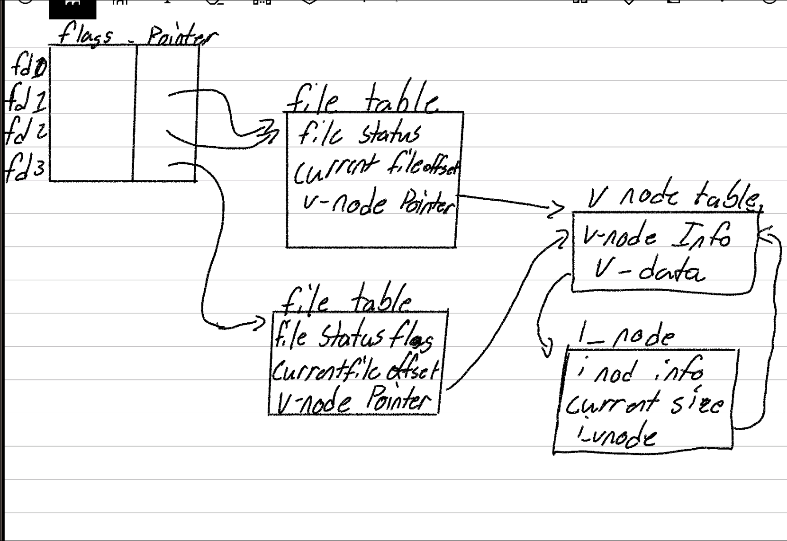

## Q)1
```text
- old fd : 3
- new duped fd: 5
- /proc/self/fd/3: old fd path: /csegrid/home/abrycen/csci3751/HW3/output
- /proc/self/fd/5: new fd path: /csegrid/home/abrycen/csci3751/HW3/output

```

## Q)2
    
    fd1 and fd2 point to the same file tale entry because fd2 was createed using dup(fd1).
    fd3 points to a separate file table entry because it was created using another open() call . 
    All three file descriptors refer to the same file. 
    F_SETFD: only fd1 is affected because file descriptor flags are maintained separately for each descriptor 
    F_SETFL: Both fd1 and fd2 are affected because they share the same file table entry and file status flags. fd3 is unaffected 




## Q)3 

```text

=== Original File ===
/csegrid/home/abrycen/csci3751/HW3/q3_links
6053534 -rw-r--r-- 1 abrycen domain users 19 Oct 24 16:36 a.txt
This is a.txt file
=== Create Links ===
total 8
6053534 -rw-r--r-- 2 abrycen domain users 19 Oct 24 16:36 a.txt
6053534 -rw-r--r-- 2 abrycen domain users 19 Oct 24 16:36 ha.txt
6053536 lrwxrwxrwx 1 abrycen domain users  5 Oct 24 16:36 sa.txt -> a.txt
This is a.txt file
This is a.txt file
=== File Paths ===
/csegrid/home/abrycen/csci3751/HW3/q3_links
total 8
-rw-r--r-- 2 abrycen domain users 19 Oct 24 16:36 a.txt
-rw-r--r-- 2 abrycen domain users 19 Oct 24 16:36 ha.txt
lrwxrwxrwx 1 abrycen domain users  5 Oct 24 16:36 sa.txt -> a.txt
=== Modify File ===
This is a.txt file
Modified via hard link
This is a.txt file
Modified via hard link
This is a.txt file
Modified via hard link
=== Copy Original ===
total 12
6053537 -rw-r--r-- 1 abrycen domain users 42 Oct 24 16:36 aa.txt
6053534 -rw-r--r-- 2 abrycen domain users 42 Oct 24 16:36 a.txt
6053534 -rw-r--r-- 2 abrycen domain users 42 Oct 24 16:36 ha.txt
6053536 lrwxrwxrwx 1 abrycen domain users  5 Oct 24 16:36 sa.txt -> a.txt
=== Remove Original ===
total 8
6053537 -rw-r--r-- 1 abrycen domain users 42 Oct 24 16:36 aa.txt
6053534 -rw-r--r-- 1 abrycen domain users 42 Oct 24 16:36 ha.txt
6053536 lrwxrwxrwx 1 abrycen domain users  5 Oct 24 16:36 sa.txt -> a.txt
=== Test Hard Link ===
This is a.txt file
Modified via hard link
=== Test Soft Link ===
cat: sa.txt: No such file or directory
=== Restore Original Path ===
total 8
6053537 -rw-r--r-- 1 abrycen domain users 56 Oct 24 16:36 a.txt
6053534 -rw-r--r-- 1 abrycen domain users 42 Oct 24 16:36 ha.txt
6053536 lrwxrwxrwx 1 abrycen domain users  5 Oct 24 16:36 sa.txt -> a.txt
=== Compare Soft Link ===
=== Compare Hard Link ===
3d2
< Modified copy
```

```shell
 [abrycen@csci-gnode-02 HW3]$ mkdir q3_links
[abrycen@csci-gnode-02 HW3]$ cd q3_links
[abrycen@csci-gnode-02 q3_links]$ echo "This is a.txt file" > a.txt
[abrycen@csci-gnode-02 q3_links]$ pwd
/csegrid/home/abrycen/csci3751/HW3/q3_links
[abrycen@csci-gnode-02 q3_links]$ ls -li a.txt
6053532 -rw-r--r-- 1 abrycen domain users 19 Oct 24 15:17 a.txt
[abrycen@csci-gnode-02 q3_links]$ cat a.txt
This is a.txt file
[abrycen@csci-gnode-02 q3_links]$
[abrycen@csci-gnode-02 q3_links]$
[abrycen@csci-gnode-02 q3_links]$ ln -s a.txt sa.txt
[abrycen@csci-gnode-02 q3_links]$ ln a.txt ha.txt
[abrycen@csci-gnode-02 q3_links]$ ls
a.txt  ha.txt  sa.txt
[abrycen@csci-gnode-02 q3_links]$ ls -li
total 8
6053532 -rw-r--r-- 2 abrycen domain users 19 Oct 24 15:17 a.txt
6053532 -rw-r--r-- 2 abrycen domain users 19 Oct 24 15:17 ha.txt
6053533 lrwxrwxrwx 1 abrycen domain users  5 Oct 24 15:18 sa.txt -> a.txt
[abrycen@csci-gnode-02 q3_links]$ cat a.txt
This is a.txt file
[abrycen@csci-gnode-02 q3_links]$ cat ha.txt
This is a.txt file
[abrycen@csci-gnode-02 q3_links]$ cat sa.txt
This is a.txt file
[abrycen@csci-gnode-02 q3_links]$ echo "modified via hard link" >> ha.txt
[abrycen@csci-gnode-02 q3_links]$ cat a.txt
This is a.txt file
modified via hard link
[abrycen@csci-gnode-02 q3_links]$ cat ha.txt
This is a.txt file
modified via hard link
[abrycen@csci-gnode-02 q3_links]$ cat sa.txt
This is a.txt file
modified via hard link
[abrycen@csci-gnode-02 q3_links]$ cp a.txt aa.txt
[abrycen@csci-gnode-02 q3_links]$ ls -li
total 12
6053535 -rw-r--r-- 1 abrycen domain users 42 Oct 24 15:19 aa.txt
6053532 -rw-r--r-- 2 abrycen domain users 42 Oct 24 15:19 a.txt
6053532 -rw-r--r-- 2 abrycen domain users 42 Oct 24 15:19 ha.txt
6053533 lrwxrwxrwx 1 abrycen domain users  5 Oct 24 15:18 sa.txt -> a.txt
[abrycen@csci-gnode-02 q3_links]$ rm a.txt
[abrycen@csci-gnode-02 q3_links]$ ls -li
total 8
6053535 -rw-r--r-- 1 abrycen domain users 42 Oct 24 15:19 aa.txt
6053532 -rw-r--r-- 1 abrycen domain users 42 Oct 24 15:19 ha.txt
6053533 lrwxrwxrwx 1 abrycen domain users  5 Oct 24 15:18 sa.txt -> a.txt
[abrycen@csci-gnode-02 q3_links]$ cat ha.txt
This is a.txt file
modified via hard link
[abrycen@csci-gnode-02 q3_links]$ cat sa.txt
cat: sa.txt: No such file or directory
[abrycen@csci-gnode-02 q3_links]$ echo "Modified capy after original removal" >> aa.txt
```

### Observation 

a.txt and ha.txt both have the same i node with a link count of 2. The symbolic link sa.txt has its own indoe, and points to a path.
Editing the hard link changes the same underlying file. Both the original pathname and the symbolic link also show the updated contents. 
The hard link still works because it references the original indode, but the symbolic link is now broken because its target pathname no longer exists.
The symbolic/ soft link works again because the pathaname a.txt ecists again. However the hard link still reerences the original indode and its old
contents. This proves that a soft link follows a pathname, while a hard links an indode.

# Q)4
```text
rmdir succeeded!
.: FAILED, errno = 116
../hw3: FAILED, errno = 116
/csegrid/home/abrycen/q4lab/hw3: FAILED, errno = 2
```
# Q)5 

the purpose of calling fflush() followd by fsync() is to make sure that buffedred file data is written to persistent storege.
fflush(afilepointer) flushes data from the c standard I/O buffer to the kernel file buffer. It take a file pointer but does not guarantee the data is 
saved to disk 

fsync(fileno(afilepointer)) synchronizes the kernel buffered file data and required metadata to persistent storage. fileno converts the file pointer to an
integer file descriptor

order matters because fflush must run fist so the kernel receives all buffered data before fsync synchronizes it.

if both succeed, the file data is synchronized to storage. However, newly created filename may also require synchronizing the parent directory. Both calls should be checked for errors 


